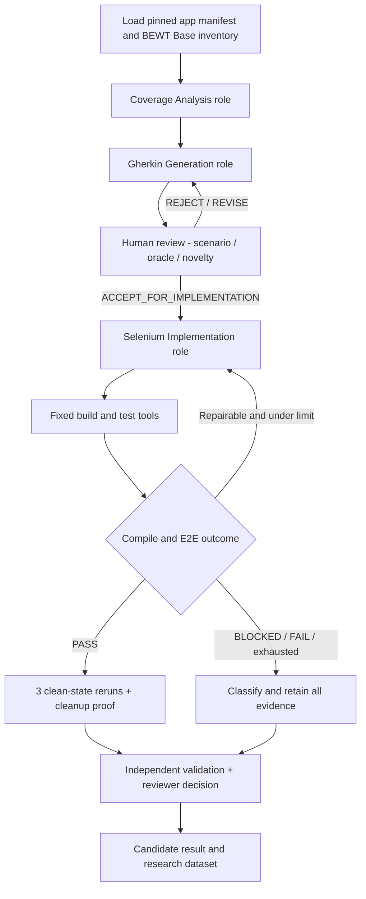

# BEWT-CovExt — Architecture & Implementation Roadmap

## 1. Cách vận hành mục tiêu

**4 vai trò chuyên trách** là logical responsibilities — cần bằng chứng chúng tồn tại thật trong LangGraph workflow. Có thể dùng nodes/shared services thay vì bốn hệ thống LLM tách biệt nếu chúng tuân thủ hợp đồng vai trò, state, tool calls và review gates; document design choice trước khi triển khai.

## 2. Kiến trúc tối thiểu, ưu tiên tái sử dụng

- `framework/`: orchestration LangGraph JS, typed state, checkpoint, role nodes, Gemini adapter, validation policy, fixed tool dispatcher, bounded repair, event/result recording.
- `config/apps/<app>.json`: manifest ứng dụng (source version, runtime, Base suite path, fixture/reset/driver, command allowlist, constraints, evidence).
- `adapters/<app>/`: lớp mỏng riêng cho app (đọc inventory, env/fixture, test harness, UI specifics); không copy nguyên lõi Agent tám lần.
- `extension/<app>/{gherkin,selenium}/`: artifacts mới, giữ nguyên candidate ID và version.
- `data/{candidates,approvals,results}/`: dataset dạng có schema, reviewer decisions, run IDs, source commit, evidence paths.
- `docs/program/STATUS.json`: trạng thái chương trình đã kiểm chứng; link đến `docs/tasks/<task-id>/TASK-REPORT.md`.
- `docs/tasks/<task-id>/`: mỗi task có PLAN/RESULTS/metrics/evidence-links; raw logs/screenshot có thể ở `runs/` hoặc đường dẫn app tương ứng, nhưng không đổi vị trí mà không cập nhật index.

**Existing assets**: `experiments/expresscart/agent/` và `experiments/expresscart/bewt-suite/` là pilot, không xóa; refactor có kiểm tra parity thay vì rewrite toàn bộ. `docs/research-results/sprint-01` đến `sprint-05` và `final/` là lịch sử; chỉ bổ sung nghiên cứu 8-app qua tài liệu mới, không sửa raw metrics để khớp mục tiêu.

**T01-C progress (2026-11-08)**: the LangGraph CLI now wires model-backed Gherkin, human review, post-ACCEPT Java generation, candidate-bound immutable registration, an isolated ExpressCart Maven harness, and structured validation. The one user-authorized Gemini Gherkin request returned HTTP 400 `API_KEY_INVALID` and was not retried; no live candidate was produced. A synthetic offline path compiled through Maven `test-compile`; it is not study evidence. Live Selenium/fixture/repeats and runtime filesystem checks remain unverified. See `docs/tasks/T01-C/TASK-REPORT.md`. This progress does not advance any acceptance gate or change the eight-app/40-case scope.

## 3. Các work packages theo thứ tự phụ thuộc

| WP | Phạm vi | Sản phẩm cần có | Chốt review |
|---|---|---|---|
| **T00 — Contract bootstrap & remote audit** | Đưa governance vào repo, xác minh source tree/branch/evidence, lập gap register | report có file paths, status snapshot, task backlog, PR | Team Lead duyệt hướng kiến trúc và backlog |
| **T01 — Framework extraction** | Đọc code pilot, thiết kế typed interfaces/adapter, tách framework khỏi ExpressCart nhưng giữ kết quả pilot | 4 role contracts, tool allowlist, checkpoint/review flow, unit tests | Full vertical slice ExpressCart PASS & no regression |
| **T01-C — Model-backed generation verification** | Trước T02, kiểm chứng một vertical slice ExpressCart bằng shared LangGraph: source-backed coverage, Gemini Gherkin, human checkpoint, post-ACCEPT Gemini Java, immutable registration, isolated Maven, một Selenium E2E attempt nếu candidate được duyệt và runtime sẵn sàng | Model usage/source provenance, real human review packet/decision, immutable generated Java, compile/E2E/cleanup evidence, regression tests; nếu model authorization hoặc review/runtime thiếu thì báo PARTIAL/BLOCKED | Team Lead review T01-C evidence; không tự nghiệm thu G2/D1/G3 và không mở T02 |
| **T02 — Baseline audit / environment inventory (8 apps)** | Mỗi app pin BEWT Base, image/source/version, quyền sử dụng; audit Gherkin mismatch | 8 manifests + risk/reset plan | G0 evidence được review per app |
| **T03 — G0 rollout** | 7 app còn lại: isolated runtime, fixture, Chrome, Base smoke, reset | 7 G0 run reports + original ExpressCart manifest | Không claim G0 PASS app chưa chạy |
| **T04 — Coverage inventory/G1** | 8 app behavioral taxonomy, original mapping, 8–12 candidate proposals/app, 5 target reviewed | 8 coverage matrices, human review decisions | Review bởi 2 người khi khả thi, Team Lead duyệt decision |
| **T05 — Generation/G2-G3** | Sinh new Gherkin, Java, compile, run, 2 bounded repairs, cleanup + 3 repeats | source/tests, generation/repair/run evidence per candidate | Candidate status bằng bằng chứng, không ép tất cả PASS |
| **T06 — Evaluation/G4** | Coverage gain RQ2, scenario validity RQ1, executability RQ3, utility RQ4 | dataset D1–D7, reproducibility, stats per-app | Team Lead kiểm tra phép tính, samples, provenance |
| **T07 — Research synthesis/D8** | Tổng hợp toàn 8 app, cập nhật báo cáo chính thức | RQ1–RQ4 và findings toàn chương trình | Chỉ khi task 8-app đã ghi trạng thái thật |

T02 và T01 có thể song song nếu không đụng cùng files/resources. T03 triển khai từng app, không khởi động 8 stack cùng lúc nếu có xung đột port/tài nguyên. T04 có thể làm static inventory trước G0 nhưng **không gán VERIFIED behavior/runtime** nếu app chưa chạy.

## 4. Reusability và safety contract

- Agent không được sinh lệnh shell trực tiếp; tool dispatcher chỉ chạy tập lệnh build/test/fixture allowlisted và đường dẫn repo hợp lệ.
- Trước tool nguy hiểm: kiểm tra ownership Docker project, allowlisted path, quyền, ảnh hưởng DB; không global prune, không sửa resources MamXanh/dự án khác.
- Chỉ lưu model inputs đã sanitize; không log secret, raw credential, data người dùng; repo public.
- Không tự ý nâng Selenium/Chrome/Java/Node/Mongo nếu đã đạt compatibility; mọi đổi phiên bản phải ghi provenance và effect on comparability.
- Mỗi case: first-pass artifact bất biến, repaired artifact phiên bản mới, run IDs không ghi đè, file-level traceability tới commit/PR.
- Dữ liệu cũ BEWT (`bewt-original/`) là ignored nested repository, có ghi nhận dirty build artifacts từ lịch sử; không xóa, reset, tự thêm vào outer Git hoặc coi nó là đã được cung cấp khi clone outer repo.

## 5. Đầu ra T00 là đầu vào để triển khai tiếp

Agent thực hiện theo `TASK-00-BOOTSTRAP.md`; trước khi code T01, phải gửi PR với governance files, actual repo inventory, architecture proposal có xác nhận vị trí classes, điểm nào tái sử dụng, số gap còn thiếu, estimation theo phụ thuộc chứ không tự thu hẹp mục tiêu. Team Lead kiểm tra trên GitHub và chốt T01. Không tạo thêm một vòng 'final report' ExpressCart làm thay thế.
