# Nội dung thuyết trình cuối — 8 slides

## Slide 1 — BEWT-CovExt: mục tiêu và phạm vi thực tế

**Nội dung trên slide**

- Mục tiêu: kiểm tra feasibility của AI Agent workflow mở rộng kiểm thử E2E từ BEWT baseline.
- Case study thực nghiệm: ExpressCart `1.1.19`, upstream commit `b31302f…`.
- Scope thực hiện: 5 Gherkin candidates; 4 ACCEPT; 4 Java Selenium tests.
- Mục tiêu kế hoạch 8 ứng dụng/40 test **chưa thực hiện**.

**Evidence:** [source lock](../../../experiments/expresscart/SOURCE-LOCK.json), [S01 report](../sprint-01/SPRINT-01-RESULTS.md), [S03 report](../sprint-03/SPRINT-03-RESULTS.md).

**Gợi ý minh họa:** logo/tên ExpressCart và một nhãn scope “1 app / 4 accepted candidates”.

**Speaker notes:** “Đề tài ban đầu hướng đến tám ứng dụng, nhưng phần có evidence thực thi hiện tại chỉ là ExpressCart. Vì vậy em trình bày đây là nghiên cứu khả thi có giới hạn, không đại diện cho toàn bộ BEWT.”

## Slide 2 — Workflow AI Agent có human review

**Nội dung trên slide**

```mermaid
flowchart LR
  A[BEWT tests + Gherkin] --> B[Analyze coverage/source]
  B --> C[LangGraph + Gemini]
  C --> D[Gherkin candidates]
  D --> E[Parser + evidence checks]
  E --> F[Human review]
  F --> G[Java Selenium generation]
  G --> H[Maven module compile]
  H --> I[Fixtures + serial E2E]
  I --> J[Surefire/log/screenshot]
  J --> K[Research metrics]
```

**Evidence:** [S01 run manifest](../sprint-01/runs/2026-11-02T07-06-24-329Z-b9a90ab1/manifest.json), [S03 official generation](../sprint-03/generation/langgraph-run/README.md).

**Gợi ý minh họa:** sơ đồ trên; bên dưới đánh dấu “4 ACCEPT → Java”.

**Speaker notes:** “Agent không tự duyệt kết quả. Kịch bản qua parser và rà source trước khi Team Lead chấp nhận; test chỉ được sinh cho bốn kịch bản đã ACCEPT.”

## Slide 3 — RQ và thiết lập thực nghiệm

**Nội dung trên slide**

- RQ1: Gherkin/Java generation và human acceptance.
- RQ2: E2E execution, PASS/BLOCKED/repeatability.
- RQ3: error categories, repairs, outcome.
- Runtime: Node 14.21.3, MongoDB 4.4.29; Java 21.0.12, Maven 3.9.16, Selenium 4.35.0, Chrome/Driver 156.
- App `127.0.0.1:3111`, project Docker tách biệt.

**Evidence:** [S04 runtime manifest](../sprint-04/runtime/runtime-manifest.json).

**Gợi ý minh họa:** runtime manifest rút gọn thành sơ đồ App ↔ Mongo + Selenium client.

**Speaker notes:** “Cấu hình được ghim trong manifest và chạy trong Compose project riêng. Đây là môi trường nghiên cứu cục bộ, không phải cấu hình production.”

## Slide 4 — RQ1: từ candidate đến Java source

**Nội dung trên slide**

| Kết quả | Số liệu |
|---|---:|
| Gherkin candidates | 5 |
| Parser-valid | 5/5 |
| Team Lead ACCEPT / REVISE | 4 / 1 |
| Official generated Java test classes | 4/4 (one per accepted candidate) |
| Java test source files compiled | 38 in S03; 39 in S04 module builds (includes suite sources) |
| First Maven module compile | FAIL (one module attempt; no per-candidate compile measurements) |
| Final module compile after repair | PASS |

Novelty: **NOT_EVALUATED**; lexical hint 0/5 không phải novelty evidence.

**Evidence:** [S01 metrics](../sprint-01/metrics.json), [review decisions](../sprint-02/human-review-decisions.json), [S03 compile log](../sprint-03/compilation-langgraph-final.log).

**Gợi ý minh họa:** candidate funnel 5 → 4 accepted → 4 Java; compile lane FAIL → repairs → PASS.

**Speaker notes:** “Parser chỉ đo cú pháp. Bốn candidate được người chấp nhận và sinh thành bốn Java test classes. Các số 38 và 39 là số Java source files trong Maven suite, không phải số candidate. Compile được đo ở cấp module.”

## Slide 5 — RQ2: E2E outcomes, mẫu số rõ ràng

**Nội dung trên slide**

- S03: 4/4 BLOCKED trước oracle.
- S04 official: 14 invocations = 8 PASS + 3 behavioral FAIL + 3 BLOCKED.
- 11/14 đạt oracle; 8/11 PASS trong invocation đạt oracle.
- Candidate final PASS: 2/4 — EC-C04 và EC-C05.
- Repeats: 6/6 PASS (3 lượt mỗi candidate).

**Evidence:** [S04 metrics](../sprint-04/metrics.json), [run ledger](../sprint-04/run-metrics.csv), [C04/C05 repeat evidence](../sprint-04/fixtures/EC-C05-repeatability.txt).

**Gợi ý minh họa:** stacked bar theo invocation (PASS/FAIL/BLOCKED) và bên cạnh candidate status 2 PASS/2 unresolved.

**Speaker notes:** “Invocation không phải candidate độc lập. Ba lần chạy bị BLOCKED không tính là lỗi hành vi. Hai candidate cuối PASS đều lặp lại ba lần.”

## Slide 6 — Hai ca cần phân biệt: EC-C02 và EC-C01

**Nội dung trên slide**

- **C02 — CONFIRMED_APP_DEFECT (transient UI):** cart count `1 → 0`; AJAX empty-state text rỗng do malformed markup; sau reload xuất hiện `Cart empty`.
- **C01 — INCONCLUSIVE:** S04 ghi FAIL ở discount wait; S05 manual UI cho thấy `£138 → £128` sau apply/reload, sau remove về `£138`. Java timeout chưa xác định được application behavior hay nguyên nhân locator/timing.
- Không đổi oracle, không vá pinned source.

**Evidence:** [C02 screenshot](../sprint-05/e2e/EC-C02/independent-run/screenshots/testEmptyCartContainingProduct.png), [manual DOM record](../sprint-05/evidence/manual-ui-observations.json), [C01 Surefire XML](../sprint-05/e2e/EC-C01/TEST-tests.RemoveDiscountCodeTest.xml).

**Gợi ý minh họa:** chèn screenshot C02 và sơ đồ C01 before/after reload.

**Speaker notes:** “C02 là trạng thái giao diện tạm thời bị lỗi, còn dữ liệu cart đã xóa. C01 cho thấy cần đối chiếu thao tác UI với test runner; do chưa tìm ra nguyên nhân headless, em giữ inconclusive.”

## Slide 7 — RQ3: lỗi và repair

**Nội dung trên slide**

| Loại | Evidence | Kết quả |
|---|---|---|
| Generation/API | First module compile fail | 5 repair calls → module compile pass |
| Environment/fixture | S03 4 blocked | Không tính behavioral FAIL |
| Selector/setup | C02 selector 1; C01 precondition 2 | Được sửa, test đi tiếp |
| Content/cleanup | C05 lần đầu fail | Repair → PASS + 3/3 repeats |
| Application UI | C02 | Defect transient xác nhận |
| Unresolved | C01 | INCONCLUSIVE |

**Evidence:** [repair history](../sprint-04/repair-history.json), [S03 metrics](../sprint-03/metrics.json).

**Gợi ý minh họa:** bảng lỗi theo stage; tô màu BLOCKED riêng với FAIL.

**Speaker notes:** “Tách lớp lỗi ngăn việc đổ lỗi cho ứng dụng khi test chưa đến oracle. Repair giúp C05 pass nhưng chưa giải quyết triệt để C01/C02.”

## Slide 8 — Kết luận, giới hạn và bước tiếp theo

**Nội dung trên slide**

- Feasibility được chứng minh cho một ứng dụng; hai candidate E2E PASS ổn định.
- Empirical novelty và behavioral coverage gain so với BEWT baseline: **NOT_EVALUATED**.
- Hiệu quả so với phương pháp test-generation khác: **NOT_EVALUATED**; BEWT là benchmark, không phải thuật toán sinh test đối chứng.
- Giới hạn: một app/version, 4 accepted candidates, không có control group.
- Tiếp theo: chẩn đoán C01 headed/headless với cùng fixture/session; xử lý C02 trong patch copy sau khi baseline evidence được đóng băng; mở rộng benchmark khi có thời gian.
- EC-C03 vẫn REVISE.

**Evidence:** [final report](FINAL-RESEARCH-REPORT.md), [threats](FINAL-READINESS-REVIEW.md).

**Gợi ý minh họa:** roadmap “C01 trace → C02 isolated patch → second app → controlled comparison”.

**Speaker notes:** “Kết quả đủ để trình bày tính khả thi và bài học về kiểm chứng, nhưng chưa đủ để tuyên bố phương pháp hiệu quả hơn. Bước tiếp theo là tăng chất lượng đối chứng, không tăng số liệu bằng suy diễn.”
