# BEWT-CovExt: Nghiên cứu khả thi về mở rộng kiểm thử E2E trên ExpressCart bằng AI Agent

- **Loại nghiên cứu:** feasibility study (nghiên cứu khả thi) trên một ứng dụng.
- **Trạng thái:** Bản báo cáo hoàn chỉnh để giảng viên/Team Lead phản biện; không phải đánh giá trên toàn bộ BEWT.
- **Baseline ứng dụng:** ExpressCart `1.1.19`, upstream `mrvautin/expressCart`, commit `b31302f4e99c3293bd742c6d076a721e168118b0`.
- **Phạm vi:** 5 Gherkin candidates; 4 được chấp nhận để triển khai; 4 Java Selenium test classes được sinh; 2 candidate đạt E2E PASS sau cùng; 2 candidate còn lỗi hoặc chưa kết luận.

## Tóm tắt

Nghiên cứu này khảo sát tính khả thi của một quy trình AI Agent dùng dữ liệu kiểm thử hiện có trong benchmark BEWT để đề xuất kịch bản Gherkin, qua human review (đánh giá của người), sinh Java Selenium tests, biên dịch và chạy trên ứng dụng thật. Thực nghiệm cuối cùng tập trung vào ExpressCart; mục tiêu ban đầu 8 ứng dụng/40 test không được xem là kết quả đã đạt.

Trong run Gherkin chính thức, hệ thống sinh năm candidates; cả năm hợp lệ về cú pháp. Sau technical review và quyết định Team Lead, bốn candidate được ACCEPT để triển khai và một (EC-C03) vẫn REVISE. Bốn Java test classes được tạo bên trong LangGraph. Lần `test-compile` đầu tiên thất bại ở **cấp Maven module** do API mismatch; sau năm class-level repair calls, module compile cuối cùng PASS. Đây là một lỗi module rồi một lần compile cuối, không phải bốn phép đo độc lập theo class.

Sprint 03 gọi bốn candidate nhưng tất cả BLOCKED trước oracle do ứng dụng hoặc fixture chưa sẵn sàng. Sau khi phục hồi runtime ở Sprint 04, có 14 invocation chính thức: 8 PASS, 3 behavioral FAIL, 3 BLOCKED trước oracle; 11/14 đạt behavior oracle. Ở cấp candidate, EC-C04 và EC-C05 đạt PASS cuối cùng; mỗi test có ba lượt lặp PASS, tổng 6/6 lượt lặp. Sprint 05 xác minh EC-C02 có lỗi render empty-state tạm thời trong cập nhật AJAX; sau reload, state server-rendered đúng. EC-C01 cho tổng tiền đúng sau reload khi thao tác thủ công, nhưng Java Selenium vẫn timeout; nguyên nhân khác biệt chưa cô lập nên INCONCLUSIVE.

Kết quả hỗ trợ feasibility của pipeline trên một ứng dụng và hai candidate có E2E PASS lặp lại. Không có phép đo behavioral coverage gain so với BEWT baseline hoặc empirical novelty; cũng không có đối chứng với phương pháp test generation khác.

**Từ khóa:** End-to-End testing, BEWT, AI Agent, LangGraph, Gemini, Gherkin, Selenium, test oracle, human review, feasibility study.

## 1. Introduction & Research Motivation

End-to-End (E2E; kiểm thử xuyên suốt) kiểm tra một luồng người dùng qua giao diện và các thành phần ứng dụng tích hợp. Bộ kiểm thử E2E hữu ích cho kiểm chứng chức năng thực tế, nhưng tạo và duy trì test đòi hỏi hiểu yêu cầu, giao diện, dữ liệu, luồng ứng dụng và đồng bộ bất đồng bộ. Một benchmark dùng chung có thể giúp các nghiên cứu tái lập và so sánh; BEWT cung cấp các bộ kiểm thử Java/Selenium cùng kịch bản Gherkin cho nhiều ứng dụng web [1, 2].

BEWT-CovExt ban đầu hướng đến một framework AI Agent có thể phân tích test baseline, tìm hành vi chưa được kiểm tra, sinh Gherkin và Java/Selenium, sau đó xác minh bằng execution evidence. Kế hoạch ban đầu đặt mục tiêu tám ứng dụng và 40 test mới. Do thời gian và yêu cầu có evidence thật, phần thực nghiệm được thu hẹp vào ExpressCart. Đây là thay đổi phạm vi được ghi nhận, không phải tuyên bố đã hoàn thành phần mở rộng toàn benchmark.

Động cơ của nghiên cứu là kiểm tra một chuỗi xử lý có thể kiểm toán: sinh kịch bản không đồng nghĩa kịch bản hợp lệ; compile không đồng nghĩa E2E đúng; test fail không tự động chứng minh lỗi ứng dụng. Vì thế nghiên cứu tách syntax validation, human review, source-backed review, compilation, execution, fixture/setup, repair và repeatability.

## 2. Related Work & Research Gap

BEWT cung cấp một nền tảng thực nghiệm cho E2E web testing và các biến thể test suite, gồm Gherkin specifications, Java/Selenium, JUnit, Page Objects và cấu hình chờ khác nhau [1, 5]. Công trình mở rộng BEWT tiếp tục nhấn mạnh benchmark dùng chung, triển khai Docker và nhiều test suites trên tám web applications [2]. Đây là cơ sở để dùng ExpressCart baseline làm nguồn so sánh trong feasibility study này.

LLM-based feature-driven test generation đã được nghiên cứu trước. Alian và cộng sự đề xuất AutoE2E, suy luận feature của ứng dụng web rồi chuyển thành các kịch bản E2E, đồng thời giới thiệu E2EBench để đánh giá feature coverage [3]. Vì vậy, nghiên cứu này **không** xem việc dùng LLM, Gherkin, Selenium hay Agent làm test generation là đóng góp mới đã chứng minh. Tài liệu BEWT cũng mô tả việc sinh test script từ AI như một hướng nghiên cứu minh họa [2].

Định vị hẹp của nghiên cứu là khảo sát feasibility của quy trình dựa trên baseline BEWT: candidate generation → người duyệt → Java generation → module compile → E2E evidence, đồng thời lưu provenance và phân biệt lỗi test/runtime/application. Tài liệu hiện có chưa phải systematic literature review (tổng quan hệ thống), và không xác lập novelty của phương pháp so với AutoE2E hoặc các công trình khác. Empirical novelty của candidates so với baseline được ghi **NOT_EVALUATED**; so sánh từ reviewer rằng không thấy hành vi tương đương trong 31 baseline scenarios chỉ là kết quả rà soát tĩnh.

## 3. Research Questions

- **RQ1:** Trong phạm vi ExpressCart, workflow có thể tạo Gherkin hợp lệ, được con người chấp nhận và chuyển thành Java Selenium source đến mức nào?
- **RQ2:** Các candidate đã chấp nhận có compile và thực thi E2E ổn định trên baseline ExpressCart đến mức nào, khi tách BLOCKED khỏi hành vi FAIL?
- **RQ3:** Những nhóm lỗi nào xuất hiện trong generation, compile, fixture/setup, selector, execution và behavior; repairs có thay đổi outcome ra sao?

RQ không nhằm kiểm định “phương pháp tốt hơn BEWT”. Không có treatment/control, không có đối chứng prompt, không đo độ bao phủ mã hoặc behavioral coverage gain.

## 4. Proposed BEWT-CovExt Method

Phương pháp được thực nghiệm gồm các bước sau.

1. **Baseline collection:** tổng hợp test classes, Gherkin features và route hints của ExpressCart baseline; đầu vào của Agent được giới hạn/sanitized.
2. **Candidate generation:** Gemini tạo Gherkin candidates. Schema, parser, string-evidence checks và lexical duplicate heuristic được lưu riêng, không xem chúng là chứng minh tính đúng.
3. **Technical and human review:** đối chiếu scenario với source/UI evidence, setup, oracle và cleanup. Team Lead ACCEPT bốn candidates, giữ EC-C03 ở REVISE.
4. **Java generation:** LangGraph/Gemini sinh test classes theo accepted Gherkin, framework Java/Selenium, Page Objects và helpers. Repair history giữ các phiên bản trước/sau.
5. **Compile and execute:** Maven compile ở cấp module; test methods chạy serial với fixture riêng. Mỗi invocation được phân loại PASS, FAIL hoặc BLOCKED trước oracle; lỗi teardown và lỗi application được tách.
6. **Repeat and analyze:** candidate PASS được chạy thêm ba lượt serial với cleanup. Sprint 05 tái hiện C01/C02 trên UI và đối chiếu Java test failure với source.

Đây là workflow khả thi đã được triển khai trong phạm vi ExpressCart, không phải mô tả rằng framework multi-agent tổng quát hoặc toàn bộ pipeline tám ứng dụng đã hoàn tất.

## 5. System Architecture & Workflow

```mermaid
flowchart LR
  A[BEWT ExpressCart baseline: 31 cases/features] --> B[Coverage/source inventory]
  B --> C[LangGraph + Gemini: Gherkin candidates]
  C --> D[Schema, parser, evidence-string checks]
  D --> E[Human review: 4 ACCEPT, 1 REVISE]
  E --> F[LangGraph + Gemini: Java Selenium]
  F --> G[Maven module test-compile]
  G -->|repair history| F
  G --> H[Fixture preflight]
  H --> I[Serial Selenium E2E]
  I --> J[Surefire XML, console, screenshots, cleanup]
  J --> K[Metrics and research interpretation]
```

LangGraph cung cấp mô hình workflow dạng nodes và shared state; tài liệu chính thức mô tả cách phân tách bước, xử lý lỗi và human-in-the-loop [4]. Trong thực nghiệm này, model calls chỉ thuộc các giai đoạn generation/repair được lưu evidence; Sprint 04–05 không gọi lại Gemini. Kết quả không chứng minh kiến trúc Agent tổng quát hoạt động tốt ngoài pipeline đã chạy.

## 6. Experimental Setup

### 6.1 Subject và source pin

Subject là upstream repository `mrvautin/expressCart`, commit `b31302f4e99c3293bd742c6d076a721e168118b0`, package version `1.1.19`. Ứng dụng được chạy trong Compose project `bewt-covext-expresscart-b31302f` với app port bind loopback `127.0.0.1:3111`; MongoDB không publish host port. Runtime manifest Sprint 04 ghi Docker Engine `29.8.0`, Node `14.21.3`, MongoDB `4.4.29`; image IDs và volume/network ownership nằm trong [runtime manifest](../sprint-04/runtime/runtime-manifest.json). HTTP readiness và Mongo ping đều PASS tại thời điểm evidence ghi nhận.

BEWT ExpressCart baseline được báo cáo là 31 test classes/features. Chỉ `AddUserTest` gốc đã được dùng làm smoke baseline trong Sprint 01, sau adaptation môi trường; không chạy đủ 31 tests gốc trong nghiên cứu này. `bewt-original/` không bị sửa. 50 dirty entries tại nested repository là build/Gradle artifacts đã ghi nhận, provenance NOT_VERIFIED; chúng được giữ nguyên.

### 6.2 Toolchain và dữ liệu

Java `21.0.12`; Maven `3.9.16`; Selenium `4.35.0`; JUnit `4.12`; Chrome `156.0.8078.76`; ChromeDriver `156.0.8078.80`. ExpressCart chạy Node 14.21.3/MongoDB 4.4.29. Đây là pinned research setup, không khẳng định cấu hình production-supported.

Fixtures được tạo riêng: product/cart qua UI, active discount thử nghiệm, UUID email được preflight vắng mặt cho C04, admin credentials chỉ lấy từ ignored `.env` cho C05, slug ngẫu nhiên, static-page cleanup qua UI. Không có giá trị credential nào được ghi vào báo cáo. Sprint 04 không reset full Docker volume; isolation dựa session mới và UI cleanup. Sprint 05 dọn session UI dùng trong C01/C02 qua thao tác UI, không reset volume.

### 6.3 Mẫu nghiên cứu

Đơn vị **candidate** là một EC-Cxx scenario duy nhất (n=5 ban đầu, n=4 được ACCEPT). **Invocation** là một method run (14 official Sprint 04 invocations, cộng 2 diagnostic invocations Sprint 05). **Repeat** là một invocation bổ sung của candidate đã PASS; sáu repeats thuộc hai candidates. **Repair** là lần sửa source/test được ghi nhận, báo riêng theo class-level generation repair và S04 test repair. Các đơn vị này không cộng gộp thành “20 tests độc lập”.

## 7. Evaluation Metrics

Với metric có nhị thức phù hợp, tỷ lệ được tính `numerator / stated denominator × 100%`. Mẫu số phải cùng loại đơn vị.

| Metric | Định nghĩa và mẫu số | Trạng thái/bằng chứng |
|---|---|---|
| Gherkin parser success | Parser-valid candidates / 5 original candidates | 5/5; cú pháp, không phải semantic correctness |
| Human acceptance | ACCEPT / 5 candidates | 4/5 = 80%; một REVISE, không có REJECT |
| Source-backed accepted behavior | Accepted candidate có static source review / 4 accepted | 4/4 theo technical review; không phải E2E pass |
| Empirical novelty | Candidates được kiểm chứng bằng một protocol novelty/coverage thực nghiệm | **NOT_EVALUATED**; không tính 0% |
| Java generation | Java classes generated in official LangGraph flow / 4 accepted | 4/4 |
| First compile | Outcome của lần Maven module `test-compile` đầu tiên | Một module attempt: FAIL; không có tỷ lệ per-class |
| Final compile | Outcome của module compile cuối sau repairs | Một module attempt: PASS; suite có 38 Java test source files ở S03 và 39 ở S04; không phải số candidate classes |
| E2E behavior reach | Official S04 invocation đạt application oracle / 14 | 11/14 = 78.6%; 3 BLOCKED không phải behavioral FAIL |
| Behavioral outcomes at reached oracle | PASS 8 và FAIL 3 / 11 reached | 72.7% PASS, 27.3% FAIL trên invocation, không phải candidate rate |
| Candidate final PASS | Candidate có outcome cuối PASS / 4 accepted | 2/4 = 50% (EC-C04, EC-C05) |
| Repeatability | Repeat invocations PASS / repeats thực hiện | 6/6; hai candidates × ba repeats, không phải sáu candidates |
| Repair effectiveness | Outcome theo candidate trước/sau repair, kèm sửa đổi | Descriptive; không causal estimate do không có control group |
| Behavioral coverage gain so với BEWT baseline | Mapping hành vi/cases baseline, coverage measure và protocol đo gain | **NOT_EVALUATED** |
| Hiệu quả so với phương pháp test generation khác | Đối chứng cùng benchmark, budget và oracle | **NOT_EVALUATED** |

## 8. Experimental Results

### 8.1 RQ1 — Gherkin và Java generation

Gemini tạo năm Gherkin candidates ở run cuối Sprint 01; parser chấp nhận 5/5. Các candidate đều có string matches với evidence identifiers và không có lexical duplicate hint trong heuristic. Hai metric sau chỉ là kiểm tra kỹ thuật/lexical, không xác nhận hành vi mới. Sprint 02 technical review hoàn tất cho năm candidates; Gherkin revised 5/5 parse hợp lệ. Team Lead ACCEPT C01, C02, C04, C05 và giữ C03 REVISE. Do đó acceptance là 4/5 candidates (80%), còn một candidate chưa được chấp nhận.

Bốn accepted candidates được LangGraph/Gemini chuyển thành bốn generated Java test classes (mỗi class là một test source file). Lần Maven module compile đầu fail do API mismatches; log chỉ ra vấn đề tại C04/C05. Năm class-level repair iterations được ghi ở Sprint 03, sau đó final module compile PASS với 38 Java test source files trong suite. Sprint 04 final module `test-compile` cũng PASS, khi suite có 39 Java test source files. Số source files là quy mô module, không phải số generated candidate tests. Không báo “first compile 0/4” như bốn phép đo độc lập vì Maven build cả suite trong một module.

### 8.2 RQ2 — E2E execution

Sprint 03 bốn invocation đều bị BLOCKED trước oracle: hai app connection errors và hai fixture/config failures. Chúng không được tính behavioral FAIL.

Sprint 04 official ledger có 14 test-method invocations: 8 PASS, 3 behavioral FAIL và 3 BLOCKED theo phân loại tại thời điểm đó. Kết quả theo từng candidate như sau:

| Candidate | Invocations S04 | First invocation | Final candidate result | Repeats |
|---|---:|---|---|---:|
| EC-C02 Empty cart | 2 | Selector error, được sửa | Behavior assertion FAIL | 0 |
| EC-C04 Forgotten password | 4 | PASS | PASS | 3/3 PASS |
| EC-C01 Discount removal | 3 | Precondition/locator blocks trước khi đến check | Final run timed out tại discount UI assertion | 0 |
| EC-C05 Static page | 5 | Content assertion và cleanup lỗi | PASS sau một repair | 3/3 PASS |

Trong 14 invocation, 11 đạt behavior oracle; 8 PASS và 3 FAIL. C05 attempt-1 sinh hai Surefire testcase records (assertion và teardown) nhưng vẫn là một method invocation; vì vậy có 15 testcase records trong XML index. Bốn exploratory C04 invocations có lưu evidence nhưng excluded khỏi official metrics do chưa lưu exact-email absence preflight. Candidate-level final PASS là 2/4; first-attempt candidate PASS là 1/4. Hai passing candidates có sáu lượt repeat PASS.

Sprint 05 thêm hai diagnostic Java test-method invocations, không tạo candidate mới: C02 là assertion failure quan sát được tại trạng thái AJAX tạm thời; C01 là timeout khi Selenium chờ phần tử discount. S04 đã ghi invocation C01 này là `FAIL / APPLICATION_UI`; tuy nhiên, timeout chỉ cho biết test không thu được locator state trong thời gian chờ và không tự xác định ứng dụng sai. Manual UI sau đó cho thấy tổng tiền cập nhật sau reload, nên kết luận cấp ứng dụng cuối cùng là **INCONCLUSIVE**; phân loại S04 được giữ nguyên như kết quả lịch sử invocation-level. C02 được xác nhận là lỗi UI tạm thời trong AJAX empty-state, dù sau auto reload state được render đúng. Vì C01/C02 không có PASS cuối trong candidate pipeline, trạng thái cuối vẫn chỉ có hai candidate PASS trên bốn.

### 8.3 RQ3 — Error analysis và repairs

| Error class | Evidence | Sửa chữa và outcome |
|---|---|---|
| Generation/API mismatch | S03 first module compile FAIL, diagnostics gồm C04/C05 | 5 class-level repairs; final module compile PASS |
| Environment/fixture blocker | S03 4/4 invocations BLOCKED trước oracle: app unavailable hoặc coupon/admin fixture thiếu | Runtime/fixtures được chuẩn bị cho S04; không tính là test behavior FAIL |
| Selector/setup | S04 C02 confirmation selector sai một invocation; C01 có hai precondition/locator blocks | Sửa selectors/setup; C02 sau đó tới text oracle, C01 tới discount oracle |
| Test data/content/cleanup | C05 initial content assertion và cleanup fail | Một test repair; final PASS cùng cleanup, sau đó 3/3 repeats PASS |
| Application UI behavior | C02 immediate AJAX empty render không có text `Cart empty`; source typo và UI được đối chiếu | Defect được xác nhận ở trạng thái chuyển tiếp; message có sau reload. Không patch baseline |
| Oracle/test/runtime mismatch chưa phân giải | C01 manual UI totals đúng sau auto reload, Java headless timeout | INCONCLUSIVE; chưa đủ bằng chứng để quy cho app, oracle hoặc test selector |

Tổng repair iteration trong S04 là bốn (C02:1, C01:2, C05:1, C04:0). Con số này khác năm class-level repair calls ở S03 và không được cộng làm một “tỷ lệ repair” duy nhất. C05 là bằng chứng một repair đưa candidate từ fail sang pass/repeat; C02 và C01 không có candidate PASS sau repair.

## 9. Discussion & Error Analysis

Kết quả cho thấy chuỗi AI Gherkin → human selection → Java Selenium → compile → E2E có thể được thực hiện trên ExpressCart. Tuy nhiên, cost kỹ thuật không nhỏ: compile đầu tiên thất bại, phải sửa tương thích API; ba invocation chính thức ở S04 bị chặn trước oracle; các vấn đề selector/setup và cleanup tạo thêm repair. Vì vậy “4 Java classes generated” không đồng nghĩa “4 tests validated”.

EC-C02 cho thấy cần tách state transition khỏi stable state. Server/cart state được xóa ngay, nhưng client AJAX template sai markup trong lúc notification hiển thị; reload server-side cho nội dung đúng. Lỗi này được mô tả là `CONFIRMED_APP_DEFECT (transient UI)`, không khái quát thành dữ liệu cart bị lưu sai. Candidate Gherkin không định nghĩa thời hạn state transition, nên nghiên cứu giữ nguyên accepted oracle và không vá app.

EC-C01 cho thấy test failure không đủ để kết luận lỗi ứng dụng. Browser UI trả notification, giữ DOM cũ ngay sau thao tác rồi cập nhật discount và tổng sau automatic reload; route và `updateTotalCart` tương ứng với session và phép tính tổng. Headless Java test tiếp tục timeout. Exact browser session ID/DOM trace từ lần chạy Java không được lưu, nên chẩn đoán duplicate IDs/hidden elements hoặc khác biệt timing chưa khép kín. Không thay oracle và không gắn nhãn defect.

### Trả lời RQ

- **RQ1:** Đạt feasibility một phần: 5/5 Gherkin parse, 4/5 được chấp nhận, 4/4 accepted được sinh Java, và module compile cuối PASS sau repairs. Source-backed review có cho bốn accepted cases; empirical novelty **NOT_EVALUATED**.
- **RQ2:** 2/4 accepted candidates đạt final E2E PASS trong S04; EC-C04 và EC-C05 lặp lại 6/6. Ba invocation bị BLOCKED trong S04 được tách khỏi behavioral failures. EC-C02 có defect UI tạm thời; C01 INCONCLUSIVE.
- **RQ3:** Các nhóm lỗi gồm generation/API, environment/fixture, selector/setup, content/cleanup và application UI. Có 4 test repair iterations trong S04 và 5 class-level generation repair calls trong S03; các outcome khác nhau nên chỉ báo cáo riêng.

## 10. Threats to Validity

**Construct validity.** Parser success, source-string match và lexical duplicate hints không phải ground truth cho semantic validity hoặc novelty. Không có behavioral coverage matrix hoàn chỉnh hay instrumentation để đo coverage gain. C02 oracle không có temporal bound; C01 Java wait và manual observation mâu thuẫn.

**Internal validity.** Chỉ có một ứng dụng, một source version, bốn accepted candidates, một model family và một runtime/browser configuration. Repairs thay test code sau lần đầu. Các lần lặp dùng cùng môi trường và không phải independent candidates. S03 failures bị chi phối bởi app/fixture readiness; chúng không đo khả năng hành vi.

**External validity.** Không thể khái quát từ ExpressCart sang tám ứng dụng BEWT, mọi loại web app, phiên bản ExpressCart khác hoặc model khác. Node/Mongo versions là legacy research pin.

**Conclusion validity.** Candidate, invocation, repeat và repair có mẫu số khác nhau. Exploratory C04 runs không vào official metrics. S01 token telemetry tự mâu thuẫn (`total_tokens` khác input + output); cost không có. Empirical novelty và behavioral coverage gain so với BEWT baseline, cùng hiệu quả so với phương pháp test generation khác, là NOT_EVALUATED.

**Reproducibility.** Source commit, runtime manifest, image IDs, fixture evidence, generated sources, prompts/responses, repair logs, Surefire XML và screenshots được lưu trong evidence index. Full-volume seed fingerprint ở Sprint 04 NOT_RUN; không tuyên bố full reset được xác minh trong Sprint 04–05.

## 11. Conclusion & Future Work

Trong phạm vi ExpressCart `1.1.19`, BEWT-CovExt chứng minh được feasibility của pipeline tạo và kiểm tra test mới ở mức giới hạn: năm Gherkin candidates được tạo, bốn được người duyệt, bốn Java Selenium classes được sinh, module compile cuối PASS, và hai candidate đạt E2E PASS với ba lần lặp mỗi candidate. Đồng thời, thực nghiệm xác nhận một lỗi UI chuyển tiếp trong EC-C02 và để EC-C01 ở trạng thái INCONCLUSIVE.

Kết quả này không chứng minh novelty thực nghiệm hoặc behavioral coverage gain so với BEWT baseline. BEWT là benchmark cung cấp baseline, không phải thuật toán test generation đối chứng. Hiệu quả so với phương pháp test generation khác cũng **NOT_EVALUATED**, vì không có comparative experiment. Nghiên cứu cũng không đo giảm công sức. Mục tiêu 8 ứng dụng/40 tests trong đề cương vẫn là kế hoạch chưa thực hiện.

Ưu tiên tiếp theo là: (1) trace headed/headless C01 với cùng discount/session và ghi DOM/reload timeline; (2) xử lý C02 trên patch copy riêng chỉ sau khi baseline evidence được đóng băng; (3) xây behavioral mapping và protocol novelty; (4) nếu thời gian cho phép, mở rộng sang ứng dụng thứ hai rồi mới thiết kế đối chứng. EC-C03 vẫn cần quyết định Team Lead.

## 12. References

1. Olianas, D., Leotta, M., & Ricca, F. “BEWT: A Benchmark for End-to-End Web Testing.” *Proceedings of the 51st Euromicro Conference Series on Software Engineering and Advanced Applications (SEAA 2025)*, Lecture Notes in Computer Science, pp. 296–314. [DOI: 10.1007/978-3-032-04207-1_20](https://doi.org/10.1007/978-3-032-04207-1_20). Metadata checked against the [University of Genoa project page](https://sepl.dibris.unige.it/BEWT.php).
2. Olianas, D., Leotta, M., & Ricca, F. “BEWT: Extended Benchmarking for End-to-End Web Testing.” *Journal of Systems and Software*, 237, article 112849, 2026. [DOI: 10.1016/j.jss.2026.112849](https://doi.org/10.1016/j.jss.2026.112849).
3. Alian, P., Nashid, N., Shahbandeh, M., Shabani, T., & Mesbah, A. “Feature-Driven End-to-End Test Generation.” *47th IEEE/ACM International Conference on Software Engineering (ICSE 2025)*, pp. 450–462. [DOI: 10.1109/ICSE55347.2025.00141](https://doi.org/10.1109/ICSE55347.2025.00141). The [arXiv preprint](https://arxiv.org/abs/2408.01894) provides an accessible paper record.
4. LangChain. “Thinking in LangGraph (JavaScript).” [Official documentation](https://docs.langchain.com/oss/javascript/langgraph/thinking-in-langgraph), accessed 2026-11-03. Implementation documentation; not empirical evidence for this study.
5. OlianasD. [BEWT benchmark repository](https://github.com/OlianasD/BEWT), README, accessed 2026-11-03. Repository metadata is mutable; local baseline provenance is separately pinned in this project.
6. mrvautin. [ExpressCart upstream source](https://github.com/mrvautin/expressCart), pinned commit [`b31302f4e99c3293bd742c6d076a721e168118b0`](https://github.com/mrvautin/expressCart/tree/b31302f4e99c3293bd742c6d076a721e168118b0), package `1.1.19`.

## Evidence links

See [EVIDENCE-INDEX.md](EVIDENCE-INDEX.md) for claim-to-artifact mapping and [FINAL-RESULTS-TABLES.md](FINAL-RESULTS-TABLES.md) for denominator-aware tables.
