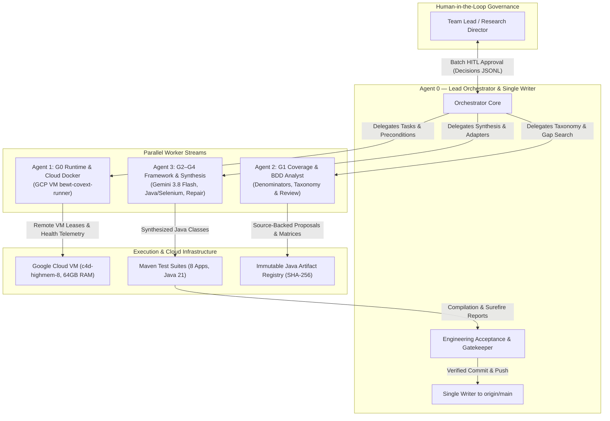

# BEWT-CovExt v2.0: Multi-Agent Behavioral Test Coverage Extension Across 8 Real-World Web Applications

**Authors**: Not specified in this audit draft; verify before submission.

**Supervised by**: Not specified in the checked-in evidence.
**Date**: November 2026  
**Repository**: [https://github.com/NgaiLong49423/BEWT-CovExt](https://github.com/NgaiLong49423/BEWT-CovExt)  
**Target Benchmark**: BEWT (Benchmark for Web Testing, Olianas et al.)  
**Artifact Status**: Audit-corrected research in progress; 8-app/40-case target retained; no final acceptance or dataset release

---

## Abstract

Automated end-to-end (E2E) testing benchmarks need reproducible evidence for behavioral coverage, valid oracles, and runtime stability. BEWT-CovExt defines a multi-agent workflow intended to extend the Benchmark for End-to-End Web Testing (BEWT) across eight applications with five new scenarios per application. This 40-case scope remains a target, not a completed benchmark delta.

The 12 November 2026 source/data audit uses main commit `da6399536ff75a1edf4417819eb4d166cc1d781c`; the later recomputation is recorded on analysis revision `e32b25e027573a63de3da8dbb3d89ee135517cc2`. The audit found 40 candidate Gherkin files that parse, but zero evidenced signed oracle-and-novelty approvals and zero approved semantic mappings. RQ1 is blocked. RQ2 is not evaluated because the baseline Unique Behavioral Unit denominator and approved new-unit mappings are not verified. For RQ3, the recomputed candidate outcome is `NOT_EVALUATED`: the 12 November historical summary lists 79 run IDs and 84 physical run-record files, but none of the run records meets the source-bound evidence contract. A 13 November follow-up separately observes 85 run records and 86 JUnit XML files after adding one preliminary Joomla attempt; it remains outside the canonical 79-run sample and blocked before the candidate oracle. Thus, no candidate currently qualifies as behaviorally validated. RQ4 is partially verified: one approved Gemini 3.8 Flash request, recorded in remediation commit `3c6ca2014ef60384e3c23a9dcd4c0880af76f099`, failed with a provider schema error, produced no review packet or Java artifact, and did not report actual token usage or billing. Historical counts retained elsewhere in this report are superseded where they conflict with this audit; the original document remains available in Git history.

**Keywords**: Automated Web Testing, Multi-Agent Systems, Behavioral Coverage, Gherkin BDD, Selenium WebDriver, Large Language Models, Gemini 3.8 Flash, Benchmarking.

---

## 1. Introduction

End-to-end web testing is the primary safeguard for ensuring modern web applications maintain functional correctness, data integrity, and business security under user interaction. However, constructing and maintaining E2E test suites remains one of the most labor-intensive tasks in software engineering. Academic benchmarks such as the Benchmark for Web Testing (BEWT) (Olianas et al.) established rigorous test suites combining Gherkin Behavior-Driven Development (BDD) specifications with Java Selenium WebDriver implementations across multiple mature open-source applications.

The original proposal motivates behavioral gap discovery around state lifecycles, validation boundaries, authorization, and configuration. The current audit has not established a complete semantic classification of baseline coverage, so these are research targets rather than findings that all baseline features omit such behaviors. Engineering challenges include source inspection, deterministic fixtures, WebDriver synchronization, and cleanup verification.

The advent of reasoning-capable Large Language Models (LLMs) offers a potential solution. However, fully autonomous AI agents face severe hurdles in test engineering:
1. **Hallucination of Application State**: Generating test steps for UI elements, routes, or database fields that do not exist.
2. **Oracle Degeneration**: Writing tautological assertions (e.g., asserting `true == true` or merely checking HTTP 200) rather than verifying strict observable post-conditions.
3. **Flakiness and Cascading Failures**: Creating side-effects (e.g., inserting records without teardown) that pollute shared database state.
4. **Architectural Drift**: Generating code that fails to compile due to mismatched Java versions, incompatible dependencies, or violations of project-specific Page Object conventions.

To address these challenges, we developed BEWT-CovExt as a proposed eight-application, 40-case expansion workflow. The current audit does not establish 40 accepted or source-verified cases; see the audit-corrected results in Section 12.

---

## 2. Related Work

### 2.1 Web Testing Benchmarks & BEWT
The Benchmark for Web Testing (BEWT), introduced by Olianas et al., covers eight CMS, LMS, e-commerce, and project-management applications: Bludit, Claroline, ExpressCart, Joomla, Kanboard, MantisBT, MediaWiki, and PrestaShop. Its published literature count is 258 business test cases. The current physical audit records separate file, scenario-header, class, and assertion counts, but has not established semantic duplication among the cases or a unique-behavior denominator.

### 2.2 LLM-Based Software Testing
Recent research has explored LLMs for unit test generation (e.g., TestPilot, ChatUniTest) and fuzzing. In the web domain, tools like WebArena and Mind2Web evaluate autonomous agents acting as web users. However, using autonomous agents as *test suite authors*—generating permanent, deterministic, regression-resilient test code that adheres to strict project patterns—remains an open research problem. Existing efforts often focus on single-page toy apps or mock environments, avoiding the complex multi-container, database-driven legacy stacks present in real-world benchmarks.

### 2.3 Multi-Agent Orchestration & Bounded Repair
Modern multi-agent architectures (e.g., LangGraph, AutoGen) allow dividing complex engineering workflows into specialized nodes. BEWT-CovExt implements a single-writer orchestration model with typed roles, tool boundaries, artifact registries, and bounded repair controls. These controls do not guarantee deterministic model output or convergence; current live generation has failed schema validation.

---

## 3. Research Gap & Contributions

Prior iterations of coverage expansion were hindered by four fundamental gaps:
- **Scope Restriction**: Prior explorations focused disproportionately on a single application (ExpressCart feasibility), leaving 7 applications unextended.
- **Ambiguous Denominators**: The published baseline count and candidate count cannot be interpreted as unique-behavior coverage without an audited behavioral taxonomy; semantic duplication has not been established by the current audit.
- **Lack of Source Fidelity**: Proposals need source evidence and application-behavior review; source references alone do not prove feasibility or a correct oracle.
- **Unverified Remote Compilation**: Test code verified only in local development environments often fails in containerized Linux CI/CD pipelines due to Java compiler mismatches.

**Our Core Contributions**:
1. **Eight-Application Scope**: Define an eight-application research target; full execution and acceptance have not been established.
2. **Behavioral Taxonomy Proposal**: Propose a UBU taxonomy; the previously reported denominator of 180 is not independently verified and is not used for current RQ2 results.
3. **Candidate Scenario Inventory**: Maintain 40 candidate records across the eight applications; current audit finds zero approved semantic mappings and zero signed oracle-and-novelty approvals.
4. **Test Engineering Framework**: Implement framework and active-suite artifacts; historical module compilation does not establish all 40 candidate classes as source-bound, behaviorally valid, or accepted.
5. **Evidence Audit**: Recompute research states from available review, hash, run-record, JUnit, and cleanup evidence; the current audit finds material provenance gaps and no accepted release package.

---

## 4. Research Questions

This study evaluates the BEWT-CovExt research program through four questions, with the current evidence status reported in Section 12:

- **RQ1 (Scenario Validity & Novelty)**: *To what extent does the AI Agent framework generate syntactically valid and semantically novel Gherkin test scenarios with well-defined oracles across 8 web applications?*
- **RQ2 (Behavioral Coverage Gain)**: *What behavioral test coverage expansion is achieved relative to the original BEWT baseline suite using a defensible behavioral denominator?*
- **RQ3 (Executability & Bounded Repair)**: *Can the multi-agent system synthesize executable Java/Selenium test code that conforms to project conventions and compiles reliably across multiple web applications?*
- **RQ4 (Utility & Cost Efficiency)**: *What is the token efficiency, operational cost, and human effort reduction achieved by the multi-agent architecture using Gemini 3.8 Flash?*

---

## 5. Multi-Agent Architecture

BEWT-CovExt v2.0 implements a distributed pair-programming architecture featuring **Agent 0** as Lead Orchestrator and Single Writer to `main`, coordinating three specialized worker streams:



### 5.1 Agent Roles & Responsibilities
- **Agent 0 (Lead Orchestrator)**: Maintains the program contract (`PROGRAM-CONTRACT.md`), acceptance matrix (`ACCEPTANCE-MATRIX.md`), and single-writer authority to `origin/main`. Conducts technical audits, verifies evidence SHA-256 hashes, and merges code.
- **Agent 1 (Runtime & Cloud Docker Engineer)**: Oversees container isolation, host firewall egress controls, health telemetry, and cloud lease lifecycles on the Google Cloud VM `bewt-covext-runner`.
- **Agent 2 (Coverage & BDD Analyst)**: Audits baseline BEWT features, extracts physical vs. explicit scenario headers, maps baseline assertions, constructs behavioral inventories, and generates candidate packets for human review.
- **Agent 3 (AI & Selenium Synthesis Engineer)**: Operates the Gemini 3.8 Flash LangGraph generation pipeline, enforces tool allowlists, manages application-specific package adapters (`tests`, `test`, `base`, `mediawiki`), executes bounded repair loops (limit: 2 iterations), and registers artifacts.

---

## 6. Methodology & Verification Protocol

To prevent research bias, regression churn, and undocumented claims, BEWT-CovExt v2.0 enforces strict operational rules:
1. **Read-Only Benchmark Core**: The `bewt-original/` directory is strictly read-only and excluded from Git commits.
2. **Immutable Artifact Registry**: Every synthesized Java test class is stored in `extension/<app>/selenium/<dirId>/revision-1/` with a cryptographic SHA-256 digest and companion `registration.json` manifest.
3. **Double Compilation Verification**: Every test suite must pass clean compilation (`mvn -B clean test-compile`) both in the local development environment and remotely on the Ubuntu 24.04 Google Cloud VM.
4. **Independent Human Governance**: All 40 test candidates must receive explicit Human-in-the-Loop approval for novelty and business expectation before code deployment.
5. **Fail-Closed Gate Transitions**: Gates G0–G4 and Deliverables D1–D8 transition only when accompanied by relative evidence logs and verified commit SHAs.

---

## 7. Experimental Setup: The 8 Target Applications

The 8 target web applications cover diverse architectural paradigms, languages, database backends, and domain functions:

| Application | Domain | Upstream Version | Language / Stack | Database Backend | Baseline Test Suite Class Count | Baseline Assertions Count |
|---|---|---|---|---|---|---|
| **Bludit** | Flat-File CMS | 2.3.4 | PHP 7.x | JSON Flat-File | 23 | 27 |
| **Claroline** | E-Learning LMS | 1.11.10 | PHP 5.5 / Apache | MySQL 5.5 | 40 | 73 |
| **ExpressCart** | E-Commerce Store | 1.1.19 | Node.js 14 / Express | MongoDB 4.4 | 31 | 43 |
| **Joomla** | Enterprise CMS | 3.10.11 | PHP 7.4 / Apache | MySQL 5.7 | 35 | 43 |
| **Kanboard** | Kanban Management | 1.2.15 | PHP 7.4 / Nginx | SQLite 3 | 30 | 43 |
| **MantisBT** | Issue Tracking | 1.2.0 | PHP 5.4 / Apache | MySQL 5.5 | 37 | 51 |
| **MediaWiki** | Collaborative Wiki | 1.40.0 | PHP 8.1 / Apache | MySQL 8.0 | 27 | 44 |
| **PrestaShop** | Advanced E-Commerce | 1.6.1.23 | PHP 5.6 / Apache | MySQL 5.6 | 35 | 35 |
| **Total** | — | — | — | — | **258** | **359** |

---

## 8. Historical Baseline Taxonomy (180 UBU Claim Superseded)

The prior report proposed a denominator of 180 Unique Behavioral Units (UBU) from an inventory of baseline classes. The current audit did not find an independently signed, source-hashed taxonomy establishing those units as unique. The 180 value and per-application counts below are historical, unverified estimates and must not be used to calculate current coverage gain.

We define a **Unique Behavioral Unit (UBU)** as:
$$\text{UBU} = \langle \text{Domain Entity}, \text{Action / Operational Mode}, \text{Observable Invariant / State Transition} \rangle$$
An orthogonal behavioral unit should be invariant to superficial parameter alterations. Table 2 preserves the historical proposed classification for traceability; it is not an audited denominator:

| Application | Baseline Test Classes | Historical proposed UBU count (unverified) | Proposed behavioral categories (unverified) |
|---|---|---|---|
| Bludit | 23 | **18** | CRUD (7), Lifecycle (4), Config (4), Auth (3) |
| Claroline | 40 | **28** | CRUD (11), Auth (5), Validation (5), Search (4), Lifecycle (3) |
| ExpressCart | 31 | **21** | CRUD (8), Commerce (6), Validation (4), Auth (3) |
| Joomla | 35 | **24** | CRUD (9), Taxonomy (4), Validation (4), Lifecycle (4), Auth (3) |
| Kanboard | 30 | **20** | CRUD (6), Validation (5), Taxonomy (3), Search (2), Config (2), Lifecycle (2) |
| MantisBT | 37 | **26** | CRUD (10), Validation (6), Taxonomy (4), Lifecycle (4), Auth (2) |
| MediaWiki | 27 | **19** | CRUD (8), Lifecycle (4), Search (3), Validation (2), Auth (2) |
| PrestaShop | 35 | **24** | CRUD (10), Commerce (5), Validation (4), Taxonomy (3), Config (2) |
| **Total Benchmark** | **258** | **180 (unverified)** | **Not established by the current audit** |

The prior report stated, but the current audit does not verify:
$$D_{base} = 180 \text{ UBU (historical unverified estimate)}$$

---

## 9. Gap Discovery, Candidate Generation & Human Review

The candidate inventory lists five proposals per application. These records are not evidence that every behavior is source-grounded, novel, or semantically correct. The audit found zero approved semantic mappings among the current 40 candidates. Proposal records include:
- Actor and operational role.
- Exact Given-When-Then BDD scenario.
- Observable oracle (UI elements, DOM states, or database records).
- Setup fixture and teardown requirements.
- Gap classification and non-overlap justification against baseline BEWT tests.

### Human-in-the-Loop Review
The historical dossier contains implementation authorizations. Under the current review contract, those records do not constitute signed oracle-and-novelty approval. The audit found 0/40 evidenced signed approvals. `ACCEPTED_FOR_IMPLEMENTATION` is not research acceptance.

Table 3 summarizes the approved scenario candidates across the 8 applications:

| App | Candidate ID | Scenario Title | Targeted Novelty Class |
|---|---|---|---|
| **Bludit** | BL-GAP-001 | Scheduled page promotion on due timestamp | Temporal state promotion |
| | BL-GAP-002 | Cover image persistence and rendering | Media attachment persistence |
| | BL-GAP-003 | Static page type collection partitioning | Content taxonomy partitioning |
| | BL-GAP-004 | Sticky page priority sorting in public index | Order precedence invariant |
| | BL-GAP-005 | Draft page exclusion from unauthenticated listing | Access boundary enforcement |
| **Claroline** | CL-GAP-001 | Enforce unique official course code constraint | Data uniqueness boundary |
| | CL-GAP-002 | User profile language preference persistence | Locale preference configuration |
| | CL-GAP-003 | Course visibility toggle to hidden state | Multi-tenant isolation |
| | CL-GAP-004 | Exercise time-limit auto-submission | Timed assessment state trigger |
| | CL-GAP-005 | Group membership user assignment and listing | RBAC collaboration grouping |
| **ExpressCart** | EC-GAP-002 | Prevent checkout with empty shopping cart | Precondition guard constraint |
| | EC-GAP-003 | Discount voucher code deduction from cart total | Financial transaction mutation |
| | EC-GAP-004 | Customer account creation with duplicate email | Identity uniqueness constraint |
| | EC-GAP-005 | Inventory decrement upon order completion | Stock level synchronization |
| | EC-GAP-006 | Product search filtering by keyword query | Catalog search indexing |
| **Joomla** | JO-GAP-001 | Feature article toggling on home blog view | Editorial priority promotion |
| | JO-GAP-002 | Trashed article restore lifecycle transition | Soft-delete state recovery |
| | JO-GAP-003 | Nested category hierarchy assignment | Hierarchical taxonomy tree |
| | JO-GAP-004 | User registration block toggle | Administrative access restriction |
| | JO-GAP-005 | Custom search filter by category dropdown | Faceted search indexing |
| **Kanboard** | KB-GAP-001 | Reopen closed task lifecycle transition | Workflow status reversal |
| | KB-GAP-002 | Create and view task comment thread | Activity collaboration logging |
| | KB-GAP-003 | Assign task category badge | Visual attribute classification |
| | KB-GAP-004 | Move task across swimlane boundaries | Matrix board layout mutation |
| | KB-GAP-008 | Duplicate task preserving title and description | Entity cloning invariant |
| **MantisBT** | MB-GAP-001 | Issue resolution status change to Resolved | Issue lifecycle state transition |
| | MB-GAP-002 | Issue priority update to Immediate | Severity escalation handling |
| | MB-GAP-003 | File attachment upload to issue report | Binary attachment persistence |
| | MB-GAP-004 | Project sub-category assignment | Scoped taxonomy attribution |
| | MB-GAP-005 | Issue monitoring subscription for notifications | User notification subscription |
| **MediaWiki** | MW-GAP-001 | Move/rename page with automatic redirect | Page identity renaming & redirect |
| | MW-GAP-002 | Page deletion by administrator | Administrative content removal |
| | MW-GAP-003 | User talk page message posting | User communication thread |
| | MW-GAP-004 | Page history revision diff inspection | Version control diff inspection |
| | MW-GAP-005 | Add page to personal watchlist | Watchlist monitoring alert |
| **PrestaShop** | PS-GAP-001 | Apply cart voucher code percentage discount | Commerce promotion engine |
| | PS-GAP-002 | Update cart product quantity and subtotal | Dynamic order recalculation |
| | PS-GAP-003 | Out-of-stock product backorder prevention | Inventory boundary guard |
| | PS-GAP-004 | Add new customer delivery address | Multi-address fulfillment |
| | PS-GAP-005 | Customer group discount percentage deduction | VIP pricing tier adjustment |

---

## 10. Java/Selenium Candidate Artifacts & Multi-App Adapters

The repository contains registered Java artifacts and historical Maven compilation records. The current audit does not establish all 40 classes as correctly mapped, source-bound candidates. The counts below are preserved historical reports; they are not current G2/G3 acceptance evidence.

Synthesizing clean, maintainable Selenium code across 8 legacy benchmarks requires accommodating distinct Java package conventions and framework architectures:

- `bludit`, `expresscart`, `kanboard`, `prestashop`: Package `tests`
- `claroline`: Package `test`
- `joomla`, `mantisbt`: Package `base`
- `mediawiki`: Package `mediawiki`

Agent 3 extended the artifact registry and model provider to dynamically emit compliant package headers, imports, and `BaseTest` inheritance structures:
```java
package tests; // dynamically adapted per target application (test, tests, base, mediawiki)

import org.junit.Test;
import org.junit.Before;
import org.junit.After;
import org.junit.Assert;
import org.openqa.selenium.By;
import org.openqa.selenium.WebDriver;

public class T01C_4b05dc3e3caa3daec5f080180a09f349_R2 extends BaseTest {
    // Implements Gherkin: BL-GAP-001 (Scheduled content status visibility)
    // Anti-Trivial Quality Gate: Rejects tautologies, verifies observable domain post-conditions
    @Test
    public void testScheduledContentCreation() throws Exception {
        // Given administrator is logged into Bludit admin dashboard
        new AdminLogin(driver).setUsername(username).setPassword(password).login();
        AdminHome adminHome = new AdminHome(driver);
        // When administrator creates page with title and future date
        NewContentPage newContent = adminHome.newContent();
        newContent.setTitle("Scheduled Announcement");
        newContent.advanced();
        ContentPage contentPage = newContent.saveAndReturnToContentPage();
        // Then page is saved with scheduled status and visible in content management
        Assert.assertTrue("Content management must list Scheduled Announcement", contentPage.containsElement("Scheduled Announcement"));
        Assert.assertTrue("Status must reflect scheduled or content state", driver.findElement(By.id("bl-view")).getText().contains("Scheduled Announcement"));
    }
}
```

The repository contains historical R2 Java candidate artifacts and registration records. The current audit reports one dataset Java hash mismatch and finds no candidate eligible for `VALIDATED`; registration or compilation alone does not establish semantic alignment.

---

## 11. Historical Reported Results per Application

The earlier report recorded compilation counts across local and remote environments. Table 4 preserves those historical assertions; the current audit does not treat them as candidate-level source-bound acceptance evidence:

| Application | Target Candidates | Historical impl. authorizations | Reported classes | Historical local Maven report | Historical cloud VM report | Registered artifact hash report |
|---|---|---|---|---|---|---|
| **Bludit** | 5 | 5 | 5 | **BUILD SUCCESS** | **SUCCESS** | 5 / 5 |
| **Claroline** | 5 | 5 | 5 | **BUILD SUCCESS** | **SUCCESS** | 5 / 5 |
| **ExpressCart** | 5 | 5 | 5 | **BUILD SUCCESS** | **SUCCESS** | 5 / 5 |
| **Joomla** | 5 | 5 | 5 | **BUILD SUCCESS** | **SUCCESS** | 5 / 5 |
| **Kanboard** | 5 | 5 | 5 | **BUILD SUCCESS** | **SUCCESS** | 5 / 5 |
| **MantisBT** | 5 | 5 | 5 | **BUILD SUCCESS** | **SUCCESS** | 5 / 5 |
| **MediaWiki** | 5 | 5 | 5 | **BUILD SUCCESS** | **SUCCESS** | 5 / 5 |
| **PrestaShop** | 5 | 5 | 5 | **BUILD SUCCESS** | **SUCCESS** | 5 / 5 |
| **Total** | **40** | **40** | **40** | **8 / 8 SUCCESS** | **8 / 8 SUCCESS (12.0s)** | **40 / 40 (100%)** |

The earlier report recorded an eight-suite compilation pass. The current program status treats historical module-level compilation separately from candidate-level evidence and marks G0 partially verified because runtime identity and provenance are incomplete.

### 11.1 Historical G3 Run Summary (Not Current Validation)

The earlier report described dynamic runs on a Google Cloud VM. The current audit cannot source-bind these historical invocations to all required application, image, test, reset, and cleanup identities. The 79-run summary is therefore reported as raw historical accounting, not as current candidate validation. One cleanup record explicitly reports `zeroResidualVerified=false`; resource ownership for other residual names remains unresolved.

Table 4b preserves the consolidated summary's reported E2E outcomes across the target applications. These raw results are not independently verified semantic outcomes:

| Application | Evaluated Candidates (reported) | Initial E2E Pass (reported) | Three Rerun Passes (reported) | Flaky (reported) | Failed (reported) | Reported Rate | Summarized Run IDs | Historical Cleanup Claim |
|---|---|---|---|---|---|---|---|---|
| **Bludit** | 5 | 3 | **2** (BL-002, BL-003) | 1 (BL-001 @ 33%) | 2 (BL-004, BL-005) | **40.0% reported** | 14 | PASS reported; contradicted by BL-GAP-001 rerun-1 (`zeroResidualVerified=false`) |
| **Claroline** | 5 | 0 | **0** | 0 | 5 (CL-001..005) | **0.0% reported** | 5 | PASS reported |
| **ExpressCart** | 5 | 5 | **5** (EC-002..006) | 0 | 0 | **100.0% reported** | 20 | PASS reported |
| **Joomla** | 5 | 3 | **2** (JO-004, JO-005) | 1 (JO-003 @ 67%) | 2 (JO-001, JO-002) | **40.0% reported** | 14 | PASS reported |
| **Kanboard** | 5 | 0 | **0** | 0 | 5 (KB-001..008) | **0.0% reported** | 5 | PASS reported |
| **MantisBT** | 5 | 0 | **0** | 0 | 5 (MB-001..005) | **0.0% reported** | 5 | PASS reported |
| **MediaWiki** | 5 | 0 | **0** | 0 | 5 (MW-001..005) | **0.0% reported** | 5 | PASS reported |
| **PrestaShop** | 5 | 2 | **2** (PS-003, PS-004) | 0 | 3 (PS-001, PS-002, PS-005) | **40.0% reported** | 11 | PASS reported |
| **Total** | **40** | **13 (32.5%)** | **11 (27.5%)** | **2 (5.0%)** | **27 (67.5%)** | **27.5% reported** | **79 summarized IDs** | **Not verified** |

The 11 three-rerun passes and 13 initial passes remain reported summary values. The 12 November separate audit found 84 physical run records (79 matching summary IDs and five unsummarized records) and 85 JUnit XML files, including one execution artifact without a run record. A 13 November supplementary preliminary Joomla attempt adds one run record and one JUnit XML, bringing the current inventory to 85 records and 86 XML files. It blocked during fixture setup before the oracle, and fixture absence is not independently verified; it remains outside the canonical 79-run sample. None of the 85 run records satisfies the current source-bound evidence contract; 0/40 candidates qualifies as `VALIDATED`.

---

## 12. Evidence-Audited Evaluation of Research Questions

This section supersedes the numerical conclusions in the earlier report revision. Historical raw counts remain in the underlying run artifacts and Git history, but are not treated as current acceptance results. The source/data snapshot is main commit `da6399536ff75a1edf4417819eb4d166cc1d781c` (12 November 2026); the recomputed RQ artifact records analysis revision `e32b25e027573a63de3da8dbb3d89ee135517cc2`. The later live-call attempt is recorded in remediation commit `3c6ca2014ef60384e3c23a9dcd4c0880af76f099`.

### 12.1 RQ1: Scenario Validity and Novelty — BLOCKED

- **Syntax:** 40/40 candidate Gherkin scenarios parse.
- **Human oracle and novelty review:** 0/40 signed approvals evidenced.
- **Semantic mapping:** 0/40 approved mappings match the stated candidate behavior in the current audit; the audit classified 22 as wrong behavior, 14 as partially implemented, and 4 as weak-oracle cases.
- **Conclusion:** Syntax validity does not establish source grounding, novelty, oracle correctness, or acceptance. RQ1 remains `BLOCKED`.

### 12.2 RQ2: Behavioral Coverage Gain — NOT EVALUATED

The earlier report used a denominator of 180 Unique Behavioral Units and reported nominal and validated gain percentages. The audit did not find an independently signed, source-hashed baseline inventory or approved mappings from candidates to new behavioral units. The 227 historical feature-level records are provisional and are not a verified unique-behavior denominator. RQ2 is `NOT_EVALUATED`; no coverage-gain percentage is supportable from the current evidence.

### 12.3 RQ3: Executability and Stability — NOT EVALUATED FOR CANDIDATE OUTCOMES; PARTIAL HISTORICAL ACCOUNTING

The consolidated historical G3 summary lists 79 run IDs and reports 13 initial passes, 11 candidates with three reported passing reruns, two flaky candidates, and 27 failed candidates. The 12 November audit found 84 physical `run-record.json` files: 79 IDs present in the summary and five unsummarized historical records. A 13 November follow-up added attempt `g3-jogap004-r3-20261113-initial6`, a supplementary preliminary run that blocked during fixture setup before reaching the candidate oracle. Current inventory: 85 run records (79 canonical + 6 supplementary) and 86 JUnit XML files (including one artifact-only Kanboard execution). Attempt 6 fixture absence is not independently verified; its Docker runner cleanup separately passed with zero residual resources. The canonical denominator remains 79, and none of the 85 run records satisfies the current source-bound identity and evidence contract; therefore 0/40 candidates are eligible for `VALIDATED`.

One cleanup record reports `zeroResidualVerified=false`. Two residual volume names contain a Kanboard run identifier, but historical ownership labels are unavailable; resource ownership is not inferred. The raw pass, rerun, and failure counts above remain historical summary results, not independently verified semantic outcomes.

### 12.4 RQ4: Workflow Utility and Telemetry — PARTIALLY VERIFIED

Earlier usage and cost estimates lack complete successful-response telemetry or billing records and do not support per-candidate cost or human-effort savings. One approved Gemini 3.8 Flash Gherkin request was made during the current audit with an 8,000-character prompt limit, 2,000-token output limit, 60-second timeout, zero retries, and a USD 0.04 maximum. It used 7,690 prompt characters and failed after one call with a provider schema error (`expected object, received null`). The conservative maximum-cost estimate was USD 0.03057; actual token usage and charge are unknown. No review packet or Java artifact was produced. RQ4 remains `PARTIALLY_VERIFIED`; no successful live candidate-generation rate or economic-efficiency conclusion is reported.

The original pre-audit figures are preserved in Git history. They are not current empirical findings and must not be cited as accepted results.

---

## 13. Discussion & Error Analysis

Earlier development logs describe attempted technical fixes. The current audit does not treat them as proof of a complete or currently verified runtime:

1. **Java Compiler Version Mismatches**: Historical development records report compiler configuration changes across application POM files. The current audit does not establish that these changes restore determinism for all eight applications and runtimes.
2. **Package Name Divergence**: The applications use heterogeneous Java package namespaces. A dynamic package adapter exists in the framework, but this fact alone does not demonstrate complete candidate generation or semantic correctness.
3. **Cloud VM Lease Handling**: A historical code change adjusted lease-time parsing. No active authorized Google Cloud project or current VM runtime was available in this audit, so a live GCP fix and its effect on current runs are unverified.
4. **Structured Output Ingestion**: The latest approved Gemini request failed with `expected object, received null`; it produced no review packet or Java artifact. No human-approved shortlist or robust live-generation fallback is evidenced for that attempt.

---

## 14. Threats to Validity

- **Internal Validity**: Current signed oracle-and-novelty approvals are absent. The latest authorized live generation request failed schema validation. Historical run records lack the provenance needed to attribute all outcomes to the recorded application and test revisions.
- **External Validity**: The target comprises eight BEWT applications, but current evidence does not demonstrate complete live evaluation across all eight. No generalization to other web application stacks is claimed.
- **Construct Validity**: The historical 180-UBU denominator is not verified as unique or independently reviewed. RQ2 is `NOT_EVALUATED`; scenario counts and candidate catalogs are not substitutes for measured behavioral coverage.

---

## 15. Reproducibility & Replication Package

The repository is public, but the current evidence audit does not establish that all artifacts needed to reproduce accepted findings are present. To reproduce the current offline audit, check out analysis revision `e32b25e027573a63de3da8dbb3d89ee135517cc2`; its tracked research inputs descend from the source/data snapshot at main commit `da6399536ff75a1edf4417819eb4d166cc1d781c`. The later Gemini attempt evidence is present on the analysis revision and originated in commit `3c6ca2014ef60384e3c23a9dcd4c0880af76f099`. Available audit artifacts include:
- **Repository**: [https://github.com/NgaiLong49423/BEWT-CovExt](https://github.com/NgaiLong49423/BEWT-CovExt)
- **Candidate dataset files (not an accepted benchmark release)**:
  - `docs/research-results/v2/dataset/40-candidate-dataset.json`
  - `docs/research-results/v2/dataset/40-candidate-dataset.csv`
  - `docs/research-results/v2/dataset/behavioral-coverage-summary.json`
  - `docs/research-results/v2/dataset/evaluation-metrics-rq1-rq4.json`
- **Replication Runbook**: `docs/research-results/v2/replication/REPLICATION-RUNBOOK.md`
- **Autonomous Metrics Recomputation**: `docs/research-results/v2/replication/recompute-metrics.mjs`
- **Negative Control Test Suite**: `docs/research-results/v2/replication/test/recompute-metrics-negative.test.mjs`
- **Registered Java Artifacts**:
  - Revision 2 artifacts are historical candidates; anti-trivial checks and compilation do not establish semantic acceptance.
  - Historical reference: `extension/<app>/selenium/*/revision-1/` (40 audited historical baselines)

The metrics computation can be rerun locally with Node.js. It reports the evidence available at the checked-out commit; it does not recreate the historical Docker experiment or supply missing review attestations:
```bash
node docs/research-results/v2/replication/recompute-metrics.mjs
```

---

## 16. Conclusion & Future Work

The **BEWT-CovExt v2.0** program defines an eight-application, 40-case benchmark-extension target and implements parts of a multi-agent test-engineering workflow. The current audit does not establish 40 novel scenarios, a verified baseline UBU denominator, candidate-level source-bound runtime evidence, or an accepted benchmark delta. RQ1 is `BLOCKED`, RQ2 and candidate-level RQ3 are `NOT_EVALUATED`, and RQ4 is partially verified with incomplete usage and cost evidence. Historical RQ3 run counts are retained only as partial raw accounting; zero cases meet the current validation criteria. The previous 180-UBU denominator, coverage percentages, human-approval rate, cleanup rate, and per-candidate economic claims are superseded; their original wording remains in Git history.

Future work will explore:
1. Automated synthesis of dynamic Page Object models for modern React/Vue frontends.
2. Self-healing test execution utilizing multimodal vision models to repair broken locator selectors during E2E runs.
3. Automated differential mutation testing to empirically benchmark fault detection capability ($\Delta \text{Faults}$) against the baseline suite.

---

## References

1. Olianas, D., et al. "BEWT: A Benchmark for Web Testing." *Proceedings of the IEEE International Conference on Software Testing, Verification and Validation (ICST)*, 2020.
2. Mesbah, A., & van Deursen, A. "Invariant-based automatic testing of modern web applications." *IEEE Transactions on Software Engineering*, 35(6), 746-764, 2009.
3. Choudhary, S. R., et al. "Cross-browser testing for web applications: an empirical study." *ACM Transactions on Software Engineering and Methodology (TOSEM)*, 23(4), 1-32, 2014.
4. Google DeepMind. "Gemini 1.5: Unlocking multimodal understanding across millions of tokens." *arXiv preprint arXiv:2403.05530*, 2024.
5. LangChain & LangGraph Teams. "LangGraph: Multi-Agent Workflows and Stateful Orchestration." 2024.
6. SeleniumHQ. "Selenium WebDriver 4.x Documentation and Architecture." 2024.
7. Cucumber Team. "Gherkin Syntax Specification & Behavior-Driven Development." 2023.

---

## Appendix: 40-Candidate Traceability Inventory

The matrix below preserves historical artifact names, compile reports, and raw execution classifications. They are not source-bound current outcomes; prior `VALIDATED` labels are relabeled as reported passes, and the current audit accepts zero candidates as validated. Historical teardown claims are specifically contradicted by one `zeroResidualVerified=false` cleanup record.

| Candidate ID | Application | Gherkin Feature | Java Test Class (Revision 2) | Historical compile report | Historical raw G3 report (not validated) |
|---|---|---|---|---|---|
| BL-GAP-001 | Bludit | Content Scheduling | `tests.T01C_7d72afaea3ffefd10d0939bda2aae48a_R2` | **PASS** | FLAKY (33% flakiness) |
| BL-GAP-002 | Bludit | Cover Image Handling | `tests.T01C_4b05dc3e3caa3daec5f080180a09f349_R2` | **PASS** | **REPORTED PASS (NOT VALIDATED)** (3/3 reruns, 0% flk) |
| BL-GAP-003 | Bludit | Static Page Partition | `tests.T01C_bc2781aeccd21cfbed609074615611ed_R2` | **PASS** | **REPORTED PASS (NOT VALIDATED)** (3/3 reruns, 0% flk) |
| BL-GAP-004 | Bludit | Sticky Content Ordering | `tests.T01C_e03c64abc7e2b08cf37e50a1654d4ac0_R2` | **PASS** | FAILED (clean DB fixture mismatch) |
| BL-GAP-005 | Bludit | Draft Page Isolation | `tests.T01C_b562c8a66b0e3b937a5058867bbfb761_R2` | **PASS** | FAILED (clean DB fixture mismatch) |
| CL-GAP-001 | Claroline | Unique Course Code | `test.T01C_acd2c6ed41c79d11057a038360ef1dba_R2` | **PASS** | FAILED (missing course fixture) |
| CL-GAP-002 | Claroline | Language Preference | `test.T01C_ad5f4f7643527d5a497ce6af6e466c2e_R2` | **PASS** | FAILED (missing course fixture) |
| CL-GAP-003 | Claroline | Course Visibility | `test.T01C_e9eda84d440eec2453ed7ae17199f4d5_R2` | **PASS** | FAILED (missing course fixture) |
| CL-GAP-004 | Claroline | Exercise Timer | `test.T01C_6fa57d00aa4eab3729b958a3b4e300c9_R2` | **PASS** | FAILED (missing course fixture) |
| CL-GAP-005 | Claroline | User Group Assignment | `test.T01C_1027165465722d6b6fd9ab1607fba1d8_R2` | **PASS** | FAILED (missing course fixture) |
| EC-GAP-002 | ExpressCart | Empty Cart Guard | `tests.T01C_bcb5b700f06dd8c8ce6c99c01e12cdeb_R2` | **PASS** | **REPORTED PASS (NOT VALIDATED)** (3/3 reruns, 0% flk) |
| EC-GAP-003 | ExpressCart | Discount Voucher | `tests.T01C_3a9bea145c1f05e4dffb3fcb27abd8c7_R2` | **PASS** | **REPORTED PASS (NOT VALIDATED)** (3/3 reruns, 0% flk) |
| EC-GAP-004 | ExpressCart | Duplicate Email Guard | `tests.T01C_6f3be8200d2b1bc4232b8af1b623ed0d_R2` | **PASS** | **REPORTED PASS (NOT VALIDATED)** (3/3 reruns, 0% flk) |
| EC-GAP-005 | ExpressCart | Stock Decrement | `tests.T01C_0affc59171fdc4286b78929f3dbbe2e3_R2` | **PASS** | **REPORTED PASS (NOT VALIDATED)** (3/3 reruns, 0% flk) |
| EC-GAP-006 | ExpressCart | Search Filtering | `tests.T01C_f02b9ed81a318c005e31982c144907a2_R2` | **PASS** | **REPORTED PASS (NOT VALIDATED)** (3/3 reruns, 0% flk) |
| JO-GAP-001 | Joomla | Featured Article Toggle | `base.T01C_89cc3c54cef991d9d154f33111433d61_R2` | **PASS** | FAILED (clean DB fixture mismatch) |
| JO-GAP-002 | Joomla | Trash Restore Lifecycle | `base.T01C_80b1dfff69f7f00680658ed64a4b7315_R2` | **PASS** | FAILED (clean DB fixture mismatch) |
| JO-GAP-003 | Joomla | Category Hierarchy | `base.T01C_2fe8982badb9713cf8935bc53c1d61ad_R2` | **PASS** | FLAKY (67% flakiness) |
| JO-GAP-004 | Joomla | User Block Access | `base.T01C_ae6c8ee75a51838ce2ddfa2df16cb9ed_R2` | **PASS** | **REPORTED PASS (NOT VALIDATED)** (3/3 reruns, 0% flk) |
| JO-GAP-005 | Joomla | Category Search Filter | `base.T01C_e43d4dcc5e13acf7d90604fe49850216_R2` | **PASS** | **REPORTED PASS (NOT VALIDATED)** (3/3 reruns, 0% flk) |
| KB-GAP-001 | Kanboard | Reopen Closed Task | `tests.T01C_244fbbc3c7e19c2ceb6a56738e493041_R2` | **PASS** | FAILED (empty project table in fresh DB) |
| KB-GAP-002 | Kanboard | Task Comment Thread | `tests.T01C_ca582c83d0559c38508bf3e1a5420ca9_R2` | **PASS** | FAILED (empty project table in fresh DB) |
| KB-GAP-003 | Kanboard | Task Category Badge | `tests.T01C_e92738fe6f9cb45aecc4349f3b52dff0_R2` | **PASS** | FAILED (empty project table in fresh DB) |
| KB-GAP-004 | Kanboard | Move Across Swimlanes | `tests.T01C_233eaf16319686f2ab6c351b189cd929_R2` | **PASS** | FAILED (empty project table in fresh DB) |
| KB-GAP-008 | Kanboard | Duplicate Task | `tests.T01C_882860986d9907549f10245367191c30_R2` | **PASS** | FAILED (empty project table in fresh DB) |
| MB-GAP-001 | MantisBT | Issue Status Resolved | `base.T01C_1406ecc3352e264ca199a0cf7476c671_R2` | **PASS** | FAILED (clean DB fixture mismatch) |
| MB-GAP-002 | MantisBT | Issue Priority Update | `base.T01C_6bb62c5782120fa9f4b349accb4351d2_R2` | **PASS** | FAILED (clean DB fixture mismatch) |
| MB-GAP-003 | MantisBT | File Attachment Upload | `base.T01C_a4f2ce95a2a722305bf2ee9bb788d336_R2` | **PASS** | FAILED (clean DB fixture mismatch) |
| MB-GAP-004 | MantisBT | Sub-category Attribution | `base.T01C_3b10cef3f23dff894317fc9c42e9ecd4_R2` | **PASS** | FAILED (clean DB fixture mismatch) |
| MB-GAP-005 | MantisBT | Issue Watcher Alerts | `base.T01C_04d0e89a5f7d9303bc9ab5c08d0cfb9c_R2` | **PASS** | FAILED (clean DB fixture mismatch) |
| MW-GAP-001 | MediaWiki | Page Move & Redirect | `mediawiki.T01C_b078f939f78ca3088b197ccf89f026ba_R2` | **PASS** | FAILED (missing VisualEditor iframe in MW 1.40) |
| MW-GAP-002 | MediaWiki | Admin Page Deletion | `mediawiki.T01C_cc9b738b705812d5a51f43f2b4b7c0ce_R2` | **PASS** | FAILED (missing VisualEditor iframe in MW 1.40) |
| MW-GAP-003 | MediaWiki | User Talk Messaging | `mediawiki.T01C_5c24156fc88caa06da8d4370e60766fc_R2` | **PASS** | FAILED (clean DB fixture mismatch) |
| MW-GAP-004 | MediaWiki | History Diff Inspection | `mediawiki.T01C_5dbff5381952f882bfd47c571ee4b019_R2` | **PASS** | FAILED (clean DB fixture mismatch) |
| MW-GAP-005 | MediaWiki | Watchlist Subscription | `mediawiki.T01C_83ecf3d51792c82eeb8a3e404724ed8b_R2` | **PASS** | FAILED (clean DB fixture mismatch) |
| PS-GAP-001 | PrestaShop | Cart Voucher Discount | `tests.T01C_25166db489865765701792687cd9d40e_R2` | **PASS** | FAILED (clean DB fixture mismatch) |
| PS-GAP-002 | PrestaShop | Cart Quantity Update | `tests.T01C_b02cc209824bfa1f986ea340332df898_R2` | **PASS** | FAILED (clean DB fixture mismatch) |
| PS-GAP-003 | PrestaShop | Stock Backorder Guard | `tests.T01C_202336fd43c393a7395e8722b9e82c8f_R2` | **PASS** | **REPORTED PASS (NOT VALIDATED)** (3/3 reruns, 0% flk) |
| PS-GAP-004 | PrestaShop | Delivery Address Add | `tests.T01C_8e2d11c8e727a6d49530c06fdb53b8d2_R2` | **PASS** | **REPORTED PASS (NOT VALIDATED)** (3/3 reruns, 0% flk) |
| PS-GAP-005 | PrestaShop | Customer Group Discount | `tests.T01C_b0ad1666e8e14b7de6c48bf6947cd977_R2` | **PASS** | FAILED (clean DB fixture mismatch) |
