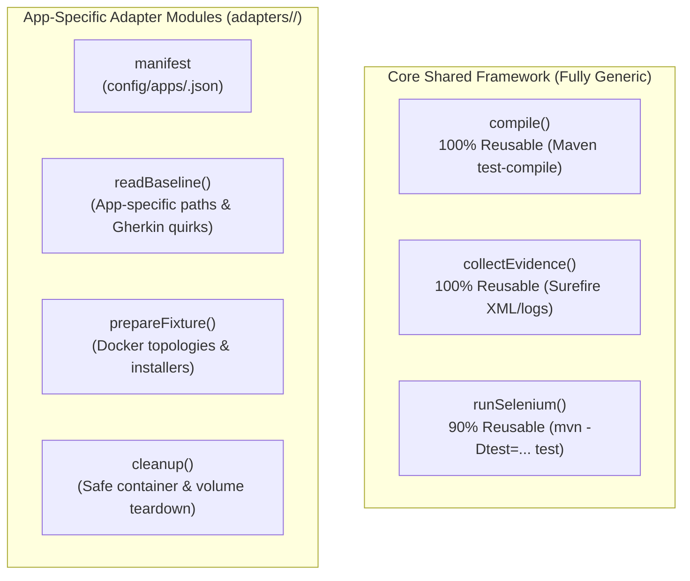

# T02 — ApplicationAdapter Gap Analysis & Reusability Assessment

> **Program:** BEWT-CovExt  
> **Task:** T02 — Benchmark Audit (Parallel Worktree)  
> **Contract References:** `framework/src/contracts.ts`, `docs/tasks/T01-A/APP-ADAPTER-CONTRACT.md`  
> **Reference Implementation:** `adapters/expresscart/`  
> **Audit Date:** 2026-11-08  
> **Verification Status:** STATIC_AUDIT_VERIFIED (architectural contract evaluation)

---

## 1. Context & ApplicationAdapter Contract

In BEWT-CovExt, application-specific concerns (Docker topologies, database fixtures, Page Object references, class naming conventions, and teardown commands) are strictly isolated behind the `ApplicationAdapter` interface defined in `framework/src/contracts.ts`:

```typescript
export interface ApplicationAdapter {
  readonly manifest: ApplicationManifest;
  readBaseline(): Promise<BaselineInventory>;
  prepareFixture(candidate: CandidateScenario, experimentKey: string): Promise<ToolResult>;
  compile(candidate: CandidateScenario): Promise<ToolResult>;
  runSelenium(candidate: CandidateScenario, generatedArtifact: GeneratedJavaArtifact): Promise<ToolResult>;
  collectEvidence(runId: string): Promise<EvidenceReference[]>;
  cleanup(candidate: CandidateScenario, experimentKey: string): Promise<ToolResult>;
}
```

The core framework (`framework/src/`) must never hardcode application paths, URLs, locators, or container names. The pilot implementation in `adapters/expresscart/` successfully validated this contract on ExpressCart. This document evaluates the reusability of that pattern across the remaining seven applications.

---

## 2. Reusability Breakdown by Interface Method



### 2.1. `manifest: ApplicationManifest`
- **Reusability Status:** **Schema Reusable; Configurations Distinct.**
- **Details:** The JSON schema (`ApplicationManifest`) in `contracts.ts` accommodates all 8 applications. Each application requires its own pinned manifest (`config/apps/<app>.json`) capturing `appId`, `benchmarkBaseVersion`, `source`, `baseSuitePath`, `runtime`, and `fixtureReset`.

### 2.2. `compile(candidate: CandidateScenario)`
- **Reusability Status:** **100% Reusable.**
- **Details:** All 8 baseline applications use Maven (`pom.xml`) with Java 21 and JUnit 4.12. Executing `mvn clean compile test-compile` inside `manifest.baseSuitePath` is completely uniform across all 8 applications.

### 2.3. `collectEvidence(runId: string)`
- **Reusability Status:** **100% Reusable.**
- **Details:** All applications output standard Maven Surefire reports to `target/surefire-reports/TEST-*.xml` and console logs. Evidence parsing, timestamping, SHA calculation, and directory archiving logic from ExpressCart can be reused without modification.

### 2.4. `runSelenium(candidate: CandidateScenario, generatedArtifact: GeneratedJavaArtifact)`
- **Reusability Status:** **90% Reusable (Minor Configuration Hook Needed).**
- **Details:** Executing a generated test class via `mvn -Dtest=<ClassName> test` is identical across all applications.
- **App-specific Gaps:**
  1. *Class Naming Conventions:* Claroline requires `Claroline_*Test`, whereas Joomla and Kanboard omit `Test`. The adapter must ensure generated test classes follow or cleanly integrate with the app's suite.
  2. *URL Parameterization:* Bludit, MantisBT 1.2.0, and PrestaShop 1.6.1.23 hardcode LAN IP `192.168.1.141` in `BaseTest.java`. The `runSelenium` command must inject `-Dapp.url=http://localhost:<port>` to override this value without editing read-only baseline files.

### 2.5. `readBaseline(): Promise<BaselineInventory>`
- **Reusability Status:** **70% Reusable (Needs App-Specific Parsers for Anomalies).**
- **Details:** The baseline reading logic parses `.feature` files and maps them to Java test classes and Page Objects.
- **App-specific Gaps:**
  1. *Bludit:* Must tolerate `.feature` files without `Scenario:` headers and resolve Gherkin from `bludit/gherkin/bludit-3.13.1` while mapping to `bludit-2.3.4`.
  2. *MantisBT:* Must handle `0_Login.feature` which has no corresponding standalone test class in `TestSuite.java`.
  3. *PrestaShop:* Must handle the 2 Java test classes (`AddEmptyTag`, `AddLanguageIsoCodeValidity`) that lack `.feature` files.

### 2.6. `prepareFixture(candidate: CandidateScenario, experimentKey: string)`
- **Reusability Status:** **Modular by Deployment Topology.**
- **Details:** Cannot be a single static script. Must implement three distinct setup workflows:
  - *Type 1 (Pre-seeded / Instant):* Claroline, Kanboard, MantisBT 1.2.0. Simply runs `docker run ...` and waits for HTTP readiness.
  - *Type 2 (Automated JUnit Wizard):* Bludit, Joomla. Starts container(s), then invokes `mvn -Dtest=Installer test` via Maven tool dispatcher.
  - *Type 3 (Two-Phase Wizard + Container Exec):* MediaWiki (copies `LocalSettings.php`), PrestaShop (removes `install/` and renames `admin` directory via `docker exec`).

### 2.7. `cleanup(candidate: CandidateScenario, experimentKey: string)`
- **Reusability Status:** **Modular by Teardown Pattern.**
- **Details:** Must remove only resources carrying the experiment label:
  - Single-container removal for Bludit, Claroline, Kanboard, MantisBT.
  - Multi-container removal for Joomla.
  - Container + named volume removal for MediaWiki and ExpressCart.
  - Container + custom network cleanup for PrestaShop.

---

## 3. Application-by-Application Gap Matrix

| Application | Manifest State | Baseline Reader Complexity | Fixture Preparation Workflow | Teardown Complexity | Estimated Adapter Code Delta vs ExpressCart |
|---|---|---|---|---|---|
| **Kanboard** | Draft Created (`kanboard.json`) | Standard (30 cases, exact 1:1 map) | Trivial: `docker run` single container, SQLite | Trivial: `docker stop; docker rm` | **Small** (~100 LOC) |
| **Claroline** | Draft Created (`claroline.json`) | Standard (40 cases, prefix `Claroline_`) | Trivial: `docker run` single container, pre-seeded DB | Trivial: `docker stop; docker rm` | **Small** (~120 LOC) |
| **Bludit** | Draft Created (`bludit.json`) | Medium: Handle implicit Gherkin syntax | Low: `docker run` + `mvn -Dtest=Installer test` | Trivial: `docker stop; docker rm` | **Medium** (~150 LOC) |
| **MantisBT** | Draft Created (`mantisbt.json`) | Low: Skip standalone check for `0_Login` | Trivial: `docker run` single container, pre-seeded DB | Trivial: `docker stop; docker rm` | **Small** (~120 LOC) |
| **Joomla** | Draft Created (`joomla.json`) | Standard (35 cases, bare class names) | Medium: Compose up + run `Installer` & `RemoveMessages` | Low: Compose down | **Medium** (~160 LOC) |
| **MediaWiki** | Draft Created (`mediawiki.json`) | Standard (27 cases) | High: Compose up + run `Installer` + `docker cp LocalSettings.php` | Medium: Volume cleanup | **High** (~220 LOC) |
| **PrestaShop** | Draft Created (`prestashop.json`) | Medium: Handle 2 missing `.feature` files | High: Network create + 2 containers + `Installer` + container `rm/mv` | Medium: 2-container cleanup | **High** (~250 LOC) |

---

## 4. Reusability Architecture Recommendation

To prevent duplicating boilerplate across eight adapter directories:
1. **Create an `AbstractApplicationAdapter` base class** in `framework/src/runtime/base-adapter.ts` that implements generic `compile()`, `collectEvidence()`, and Surefire parsing.
2. Implement specialized lifecycle hooks in subclasses:
   - `onPrepareEnvironment()` (Docker start + healthcheck)
   - `onInitializeDatabase()` (optional JUnit installer or file copy)
   - `onTeardownEnvironment()` (container and volume removal)
3. Parameterize the SUT base URL via JVM argument `-Dapp.url=...` in the base class, cleanly fixing the hardcoded `192.168.1.141` problem across Bludit, MantisBT, and PrestaShop.
