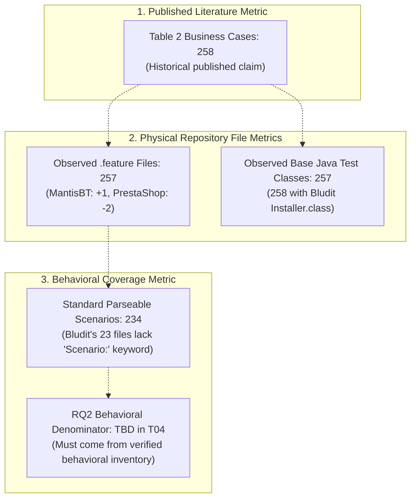

# T02 — Baseline Inventory & Test Mismatch Audit (8 Applications)

> **Program:** BEWT-CovExt  
> **Task:** T02 — Benchmark Audit (Parallel Worktree)  
> **Source Baseline Reference:** `bewt-original/` (pinned at commit `0501249ff3e9a5ea83a06155cd2971dc36197056` from `https://github.com/OlianasD/BEWT.git`)  
> **Base Commit of main:** `7e27950b44473cf4d6a5d7d5222bc8dac9b3a266` (following merge of PR #3 / T01-B)  
> **Scope Document:** `De_cuong_BEWT_CovExt_AI_Agent_8_Web_40_Kich_Ban.docx` (v2.0, 20/10/2026)  
> **Audit Date:** 2026-11-08  
> **Verification Status:** STATIC_AUDIT_VERIFIED (read-only audit of baseline repository, no runtime executed)

---

## 1. Executive Summary & Research Metrics Disambiguation

This document establishes the empirical baseline inventory for the eight target web applications in BEWT-CovExt. The research proposal v2.0 references Table 2 of Olianas, Leotta & Ricca (2026) (*BEWT: Extended Benchmarking for End-to-End Web Testing*, Journal of Systems and Software), which reports **258** original test cases across 8 applications.

A rigorous, file-by-file audit of `bewt-original/` requires clearly separating **three independent metrics**:

1. **Metric A — Published Literature Benchmark Baseline:** **258 original business cases** (Table 2 in paper and proposal v2.0). This figure remains preserved as the historical benchmark baseline claim; we do NOT rewrite historical records.
2. **Metric B — Physical Repository File Counts:**
   - **257 Gherkin `.feature` files** across the 8 applications in `bewt-original/`.
   - **257 business test classes** in Base `TestSuite.java` (258 if including Bludit's initial `Installer.class`).
3. **Metric C — Behavioral Scenarios for Coverage Measurement:**
   - **234 standard parseable scenarios**: The 23 Bludit `.feature` files completely omit the standard `Scenario:` keyword, rendering them invalid under standard Cucumber/Gherkin parsers without custom normalization.
   - **Methodological Invariant:** The denominator for RQ2 Behavioral Coverage Gain **MUST NOT** be blindly assumed as 257 files or 258 entries. Behavioral coverage gain measures new behaviors against a structured pre-expansion behavioral inventory (taxonomized in Task T04), not raw line or file counts.

---

## 2. Benchmark Baseline Summary Matrix

| Application | Proposal Base Label | Actual Base Suites in BEWT | TestSuite Java Classes (Base) | Gherkin `.feature` Files | Explicit `Scenario:` Headers | Page Object Classes (`src/main/java`) | Test Class Naming Pattern | Upstream Dereferenced Commit SHA |
|---|---|---|---|---|---|---|---|---|
| **Bludit** | `2.3.4` | `bludit-2.3.4`, `bludit-3.13.1` | 24 (1 Installer + 23 business) | 23 | 0 (implicit, lacks keyword) | 17 (in `po`) | `*Test.java` | `44de235a5eedda9b80d9f0babd9fd5cb8c6943bd` |
| **Claroline** | `1.11.10` | `claroline-1.11.10` | 40 | 40 | 40 | 22 (in `po`) | `Claroline_*Test.java` | `NOT_VERIFIED` (Legacy tarball) |
| **ExpressCart** | `1.19` (pkg `1.1.19`) | `expresscart-1.19` | 31 | 31 | 31 | 28 (in `po`, `utils`) | `*Test.java` | `b31302f4e99c3293bd742c6d076a721e168118b0` |
| **Joomla** | `3.10.11` | `joomla-3.10.11`, `joomla-4.2.0` | 35 | 35 | 35 | 31 (in `po`, `utils`) | Bare class name (no `Test` suffix) | `01deee0a7b8cf91fc503b2cc13359c6e43aac47f` |
| **Kanboard** | `1.2.15` | `kanboard-1.2.15` | 30 | 30 | 30 | 27 (in `po`) | Bare class name (no `Test` suffix) | `00a8b2d7ea55ee43e92e0e9eb193ce1e915d146b` |
| **MantisBT** | `1.2.0` | `mantisbt-1.2.0`, `mantisbt-2.25.4` | 37 | 38 | 38 | 20 (in `po`, `utils`) | Bare class name (1.2.0); `*Test.java` (2.25.4) | `d06bf60f5ed9f96029bb830a005d4819a4f87b45` |
| **MediaWiki** | `1.40.0` | `mediawiki-1.40.0` | 27 | 27 | 27 | 16 (in `po`) | `*Test.java` | `468dd69d6ee8e84b9ab26d0ee3d52f215faaf0d4` |
| **PrestaShop** | `1.6.1.23` | `prestashop-1.6.1.23`, `prestashop-1.7.8.5` | 35 | 33 | 33 | 33 (in `po`, `utils`) | Bare class name (no `Test` suffix) | `475d65fbda93403cd1afde0db09764c5295e952c` |
| **TOTAL** | — | **12 Baseline Suites** | **258** (with Bludit Installer) / **257** (business) | **257** | **234** (standard) + **23** (implicit) | **194** Page Objects across Base | Varied across 3 naming conventions | 7 Verified, 1 Unverified |

---

## 3. Detailed Application-by-Application Audit

### 3.1. Bludit

- **Upstream / Base Label:** `2.3.4` (Base), `3.13.1` (Base+)
- **Verified Upstream Commit:** `44de235a5eedda9b80d9f0babd9fd5cb8c6943bd` (from tag `2.3.4`)
- **Baseline Directory:** `bewt-original/bludit/baseline/bludit-2.3.4`
- **Gherkin Directory:** `bewt-original/bludit/gherkin/bludit-3.13.1` *(Folder named `bludit-3.13.1`, but its 23 files match `bludit-2.3.4`)*
- **POM Configuration:**
  - `selenium.version`: `4.34.0`
  - `junit.version`: `4.12`
  - `maven.compiler.source` / `target`: `21`
  - Dependencies: `selenium-java`, `junit`, `webdrivermanager:5.8.0`
- **TestSuite Structure:** `tests.TestSuite` contains **24 classes**:
  1. `Installer.class` (executes `/install.php` wizard, sets English, sets password `e2eW3Bt3s71nGB3nchM4rK`)
  2. `AddContentTest.class` through 24. `EmptyLoginFailsTest.class` (23 business tests).
- **Gherkin Syntax Anomaly:** All 23 `.feature` files lack the `Scenario:` keyword. They have `Feature:` directly followed by `Given`, `When`, `Then`. Standard Gherkin parsers return 0 scenarios.
- **Page Objects (`src/main/java/po`):** 17 classes.

### 3.2. Claroline

- **Upstream / Base Label:** `1.11.10`
- **Upstream Commit Status:** `NOT_VERIFIED` (Legacy SourceForge release; no verified GitHub Git tag).
- **Baseline Directory:** `bewt-original/claroline/baseline/claroline-1.11.10`
- **Gherkin Directory:** `bewt-original/claroline/gherkin/` (40 `.feature` files, all standard).
- **POM Configuration:** `selenium.version: 4.35.0`, `junit.version: 4.12`, Java `21`.
- **TestSuite Structure:** `test.TestSuite` contains **40 classes**, perfectly aligned with the 40 Gherkin files. Prefixed with `Claroline_`.
- **Page Objects (`src/main/java/po`):** 22 classes.

### 3.3. ExpressCart

- **Upstream / Base Label:** `1.19` (Upstream package: `1.1.19`, commit `b31302f4e99c3293bd742c6d076a721e168118b0`).
- **Baseline Directory:** `bewt-original/expresscart/baseline/expresscart-1.19`.
- **Gherkin Directory:** `bewt-original/expresscart/gherkin/` (31 `.feature` files, all standard).
- **POM Configuration:** `selenium.version: 4.35.0`, `junit.version: 4.12`, Java `21`.
- **TestSuite Structure:** `tests.TestSuite` contains **31 classes**.
- **Page Objects (`src/main/java`):** 28 classes (26 in `po`, 2 in `utils`).

### 3.4. Joomla

- **Upstream / Base Label:** `3.10.11` (Base), `4.2.0` (Base+).
- **Verified Upstream Commit:** `01deee0a7b8cf91fc503b2cc13359c6e43aac47f` (dereferenced from tag `3.10.11`).
- **Baseline Directory:** `bewt-original/joomla/baseline/joomla-3.10.11`.
- **Gherkin Directory:** `bewt-original/joomla/gherkin/` (35 `.feature` files, all standard).
- **POM Configuration:** `selenium.version: 4.35.0`, `junit.version: 4.12`, `maven.compiler.release: 21`.
- **TestSuite Structure:** `base.TestSuite` contains **35 classes** (bare names: `BadLogin.class`, `AddNewArticle.class`). `Installer.java` runs prior to suite.
- **Page Objects (`src/main/java`):** 31 classes (30 in `po`, 1 in `utils`).

### 3.5. Kanboard

- **Upstream / Base Label:** `1.2.15`.
- **Verified Upstream Commit:** `00a8b2d7ea55ee43e92e0e9eb193ce1e915d146b` (dereferenced from tag `v1.2.15`).
- **Baseline Directory:** `bewt-original/kanboard/baseline/kanboard-1.2.15`.
- **Gherkin Directory:** `bewt-original/kanboard/gherkin/` (30 `.feature` files, all standard).
- **POM Configuration:** `selenium.version: 4.35.0`, `junit.version: 4.12`, Java `21`.
- **TestSuite Structure:** `tests.TestSuite` contains **30 classes** (bare names: `AddNewProject.class`, `AddNewTask.class`).
- **Page Objects (`src/main/java/po`):** 27 classes.

### 3.6. MantisBT

- **Upstream / Base Label:** `1.2.0` (Base), `2.25.4` (Base+).
- **Verified Upstream Commit:** `d06bf60f5ed9f96029bb830a005d4819a4f87b45` (dereferenced from tag `release-1.2.0`).
- **Baseline Directory:** `bewt-original/mantisbt/baseline/mantisbt-1.2.0`.
- **Gherkin Directory:** `bewt-original/mantisbt/gherkin/` (**38 `.feature` files**).
- **POM Configuration:** `selenium.version: 4.34.0`, `junit.version: 4.12`, `maven.compiler.release: 21`.
- **TestSuite Structure:** `base.TestSuite` contains **37 classes**. `0_Login.feature` is NOT in `TestSuite.java` because login is handled in `@Before` setup.
- **Count Explanation:** 38 Gherkin files vs 37 Java test classes. Table 2 reported 37 based on Java TestSuite.
- **Page Objects (`src/main/java`):** 20 classes (19 in `po`, 1 in `utils`).

### 3.7. MediaWiki

- **Upstream / Base Label:** `1.40.0`.
- **Verified Upstream Commit:** `468dd69d6ee8e84b9ab26d0ee3d52f215faaf0d4` (dereferenced from tag `1.40.0`).
- **Baseline Directory:** `bewt-original/mediawiki/baseline/mediawiki-1.40.0`.
- **Gherkin Directory:** `bewt-original/mediawiki/gherkin/` (27 `.feature` files, all standard).
- **POM Configuration:** `selenium.version: 4.35.0`, `junit.version: 4.12`, Java `21`.
- **TestSuite Structure:** `mediawiki.TestSuite` contains **27 classes**.
- **Page Objects (`src/main/java/po`):** 16 classes.

### 3.8. PrestaShop

- **Upstream / Base Label:** `1.6.1.23` (Base), `1.7.8.5` (Base+).
- **Verified Upstream Commit:** `475d65fbda93403cd1afde0db09764c5295e952c` (from tag `1.6.1.23`).
- **Baseline Directory:** `bewt-original/prestashop/baseline/prestashop-1.6.1.23`.
- **Gherkin Directory:** `bewt-original/prestashop/gherkin/` (**33 `.feature` files**).
- **POM Configuration:** `selenium.version: 4.35.0`, `junit.version: 4.12`, Java `21`.
- **TestSuite Structure (1.6.1.23):** `tests.TestSuite` contains **35 classes**.
- **Count Explanation:** `TestSuite.java` has 35 classes, but `gherkin/` has only 33 files. `AddEmptyTag` and `AddLanguageIsoCodeValidity` exist only in Java. Table 2 reported 35 based on Java TestSuite.
- **Page Objects (`src/main/java`):** 33 classes (32 in `po`, 1 in `utils`).

---

## 4. Test Mismatch Taxonomy (M1–M6)

1. **M1 — Embedded Installer Class (Bludit):** `bludit-2.3.4/TestSuite.java` has 24 classes (1 `Installer.class` + 23 business tests). Proposal counts 23.
2. **M2 — Version Tag Mismatch in Directory Hierarchy (Bludit):** Gherkin folder is named `bludit-3.13.1`, but its 23 files match `bludit-2.3.4`.
3. **M3 — Syntax Non-conformance (Bludit Gherkin):** All 23 Bludit `.feature` files omit `Scenario:`. Strict parsers return 0 scenarios.
4. **M4 — Surplus Gherkin Specification (MantisBT):** `0_Login.feature` is present in Gherkin, but login is executed as `@Before` fixture setup rather than a standalone class in `TestSuite.java` (38 Gherkin files vs 37 Java tests).
5. **M5 — Missing Gherkin Specifications (PrestaShop):** PrestaShop 1.6.1.23 has 35 Java tests, but only 33 Gherkin feature files (`AddEmptyTag` and `AddLanguageIsoCodeValidity` lack feature files).
6. **M6 — Inconsistent Test Class Naming:** `*Test.java` (Bludit, ExpressCart, MediaWiki) vs `Claroline_*Test.java` (Claroline) vs bare class names without `Test` suffix (Joomla, Kanboard, MantisBT 1.2.0, PrestaShop).

---

## 5. Summary of Baseline Traceability

| Metric | Historical Paper Claim (Table 2) | Physical Repository Count in `bewt-original` | Parsing & Behavioral Significance |
|---|---|---|---|
| Total Target Applications | 8 | 8 | All 8 present in repository |
| Total Baseline Suites | 12 (8 Base + 4 Base+) | 12 (8 Base + 4 Base+) | All 12 present in repository |
| Gherkin `.feature` Files | 258 | **257** | MantisBT has +1 (`0_Login`), PrestaShop has -2 |
| Standard Parseable Scenarios | 258 | **234** | Bludit's 23 files lack `Scenario:` keyword; require normalization |
| Base Business Test Classes | 258 | **257** (258 with Bludit Installer) | Bludit Installer is setup, not a business test |
| Base Page Object Classes | Not reported in Table 2 | **194** classes across 8 Base suites | High asset reuse for AI Selenium generation |
| RQ2 Coverage Denominator | N/A | **To be established in T04** | Must derive from verified pre-expansion behavioral taxonomy |
