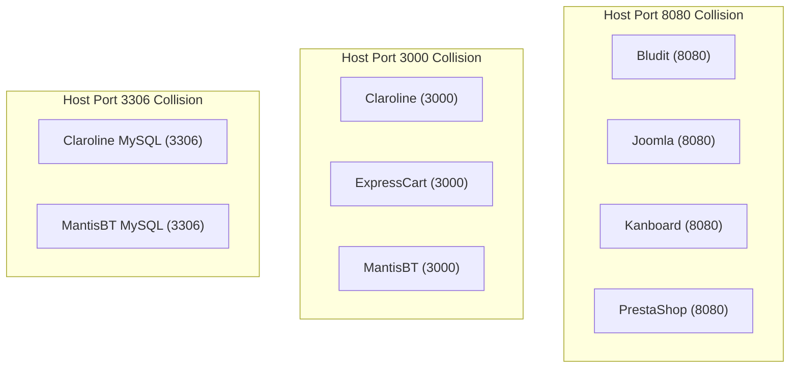

# T02 — Environment Requirements & Runtime Isolation Audit (8 Applications)

> **Program:** BEWT-CovExt  
> **Task:** T02 — Benchmark Audit (Parallel Worktree)  
> **Source Baseline Reference:** `bewt-original/` (commit `0501249ff3e9a5ea83a06155cd2971dc36197056`)  
> **Base Commit of main:** `7e27950b44473cf4d6a5d7d5222bc8dac9b3a266` (following merge of PR #3 / T01-B)  
> **Scope Document:** `De_cuong_BEWT_CovExt_AI_Agent_8_Web_40_Kich_Ban.docx` (v2.0, 20/10/2026)  
> **Audit Date:** 2026-11-08  
> **Verification Status:** STATIC_AUDIT_VERIFIED (static configuration audit, no containers launched)

---

## 1. Scope & Objective

This document analyzes the runtime infrastructure, container topology, database lifecycle, setup procedures, and teardown mechanisms for all eight applications in the BEWT benchmark. It identifies critical configuration risks—including severe port collisions, hardcoded local IP addresses in the original test code, and manual post-installation requirements—and defines safe isolation strategies for the subsequent G0 rollout (T03).

---

## 2. Environment Matrix Across 8 Applications

| Application | Tech Stack | Default Port in BEWT | Database Engine | Deployment Model | Pre-test Setup Routine | Teardown / Reset Routine | Setup Complexity |
|---|---|---|---|---|---|---|---|
| **Bludit** | PHP 7.x, Apache | `8080` (HTTP) | Flat-file (JSON under `/bl-content`) | `docker run -d -p 8080:80 bludit/docker:2.3.4` | `mvn -Dtest=Installer test` (runs first in `TestSuite`) | `docker stop; rm` (wipes all state) | **Low** |
| **Claroline** | PHP 5.6, Apache | `3000` (HTTP), `3306` (MySQL) | MySQL 5.5 (bundled inside container) | `docker run -it -d -p 3000:80 -p 3306:3306 ... olianasd/claroline-strongpsw` | None (database pre-seeded in image) | `docker stop; rm` | **Low** |
| **ExpressCart** | Node.js 14.x, Express | `3000` (HTTP) | MongoDB 4.4 (isolated container) | Docker Compose (`app` + `mongo`) | None (pre-seeded via Mongo seed scripts) | Stop compose, remove named Mongo volume | **Low** |
| **Joomla** | PHP 7.x, Apache | `8080` (HTTP) | MySQL 5.6 (separate container) | Docker Compose (`joomla-3.10.11/docker-compose.yml`) | `mvn -Dtest=Installer test` + `mvn -Dtest=RemoveMessages test` | Stop compose, remove containers (ephemeral MySQL storage) | **Medium** |
| **Kanboard** | PHP 7.x, Apache | `8080` (HTTP) | SQLite 3 (embedded in container) | `docker run -d -p 8080:80 kanboard/kanboard:v1.2.15` | None (SQLite initialized on container start) | `docker stop; rm` (wipes SQLite file) | **Very Low** |
| **MantisBT** | PHP 5.3, Apache | `3000` (HTTP), `3306` (MySQL) | MySQL 5.1 (bundled inside container) | `docker run -it -d -p 3000:80 -p 3306:3306 ... olianasd/mantisbt-strongpsw:1.2.0` | None (database pre-seeded in image) | `docker stop; rm` | **Low** |
| **MediaWiki** | PHP 8.x, Apache | `8080` (HTTP) | MariaDB / MySQL (separate container) | Docker Compose (`mediawiki-1.40.0/docker-compose.yml`) | `mvn -Dtest=Installer test` -> downloads `LocalSettings.php` -> `docker cp LocalSettings.php mediawiki-1400-mediawiki-1:/var/www/html` | Stop compose, remove containers AND remove volumes `mediawiki-1400_images`, `mediawiki-1400_db` | **High** |
| **PrestaShop** | PHP 5.6, Apache | `8080` (HTTP), `3307` (MySQL) | MySQL 5.7 (separate container) | Custom Docker network (`prestashop-net`) with two containers | `mvn -Dtest=Installer test` -> `docker exec ... rm -rf install` -> `docker exec ... mv admin administrator` | Stop and remove both containers (`some-prestashop`, `some-mysql`) | **High** |

---

## 3. Critical Environmental Findings & Operational Invariants

### 3.1. Port Collisions (Massive Concurrency Blocker)
In the original BEWT repository scripts:
- **Port 8080 is used by FOUR applications:** Bludit (`8080`), Joomla (`8080`), Kanboard (`8080`), and PrestaShop (`8080`)!
- **Port 3000 is used by THREE applications:** Claroline (`3000`), ExpressCart (`3000`), and MantisBT (`3000`)!
- **Port 3306 is exposed to host by TWO applications:** Claroline (`3306`) and MantisBT (`3306`)!



> [!WARNING]
> Running multiple applications simultaneously on the same host machine will cause immediate `bind: address already in use` failures.
> **Operational Invariants for T03/G0:**
> 1. Applications must be deployed **strictly sequentially** (one active application runtime at any given time).
> 2. The rollout harness must verify that the target port is free before container binding (`Test-NetConnection -ComputerName localhost -Port <port>` or socket check).

---

### 3.2. Hardcoded Local LAN IP (`192.168.1.141`) & Working Copy Requirement
A major finding in the code audit of `src/test/java/.../BaseTest.java`:
- In **Bludit** (`bludit-2.3.4` and `bludit-3.13.1`): `BaseTest.java` hardcodes `private String app_url = "http://192.168.1.141:8080/admin";`
- In **MantisBT** (`mantisbt-1.2.0`): `BaseTest.java` hardcodes `private String app_url = "http://192.168.1.141:3000/mantisbt";`
- In **PrestaShop** (`prestashop-1.6.1.23`): `BaseTest.java` hardcodes `private String app_url = "http://192.168.1.141:8080/administrator/";`

`192.168.1.141` was the local private IP address of the original researcher's desktop machine. On any other machine or network, tests executing against `192.168.1.141` hang or fail with connection timeouts.

> [!IMPORTANT]
> **Why `-Dapp.url` alone is insufficient on raw `bewt-original/`:**
> In the original code, `app_url` is a hardcoded string literal. The original class does **NOT** contain `System.getProperty("app.url")`. Therefore, passing `-Dapp.url=http://localhost:...` to Maven has **ZERO effect** on the unedited classes in `bewt-original/`.
> 
> **Resolution for Task T03:**
> - `bewt-original/` is strictly read-only and immutable. It must NEVER be edited in place.
> - In Task T03, the framework will create an isolated **working copy** of the test suite (e.g. `experiments/<app>/bewt-suite`), where `BaseTest.java` is updated to read `System.getProperty("app.url", defaultUrl)`.
> - This enables full parameterization without violating the read-only contract of `bewt-original/`.

---

### 3.3. Hardcoded Local Windows Paths to ChromeDriver
In multiple baseline test suites:
- **Claroline** (`claroline-1.11.10`):
  `System.setProperty("webdriver.chrome.driver", "C:/Users/User/Downloads/chromedriver-win64-chrome127/chromedriver-win64/chromedriver.exe");`
- **MantisBT 2.25.4** and **MediaWiki 1.40.0**: Contain identical hardcoded path references to `C:/Users/User/Downloads/...`.

All suites also declare `io.github.bonigarcia:webdrivermanager:5.8.0` in their `pom.xml`, and include a `setupRemoteWebdriver()` method pointing to `http://localhost:4444/wd/hub`.
**Resolution for Task T03:**
Automated executions must use WebDriverManager or containerized RemoteWebDriver (`selenium/standalone-chrome:127.0-chromedriver-127.0`), ignoring nonexistent local directories.

---

## 4. Reset & State Isolation Strategies

To guarantee the reproducibility requirements of G0, G3, and G4 (3 repeated executions starting from identical data states), reset strategies are classified into three architectural patterns:

### Pattern A: Ephemeral Single-Container (Bludit, Claroline, Kanboard, MantisBT 1.2.0)
- **Mechanism:** All application state resides inside the container's writable layer (flat-files or internal SQLite/MySQL). No external volumes are mounted.
- **Teardown Procedure:**
  ```powershell
  docker stop <container_name>
  docker rm <container_name>
  ```
- **Determinism:** 100% clean state on next `docker run`.

### Pattern B: Ephemeral Multi-Container Compose (Joomla 3.10.11)
- **Mechanism:** Joomla and MySQL run as separate services, but MySQL volume is anonymous/ephemeral (not a named persistent volume).
- **Teardown Procedure:**
  ```powershell
  docker compose down --volumes --remove-orphans
  ```
- **Determinism:** High. The database starts fresh on `docker compose up -d`.

### Pattern C: Persistent Named Volumes with Post-Exec (MediaWiki 1.40.0, PrestaShop 1.6.1.23, ExpressCart)
- **Mechanism:** Database or uploads persist across runs in named volumes or dedicated networks.
- **MediaWiki:** Uses named volumes `mediawiki-1400_images` and `mediawiki-1400_db`. Teardown must explicitly remove both volumes:
  ```powershell
  docker stop mediawiki-1400-mediawiki-1 mediawiki-1400-database-1
  docker rm mediawiki-1400-mediawiki-1 mediawiki-1400-database-1
  docker volume rm mediawiki-1400_images mediawiki-1400_db
  ```
- **PrestaShop:** Uses custom network `prestashop-net` and requires post-install container modification:
  ```powershell
  docker exec some-prestashop bash -c "rm -rf install && mv admin administrator"
  ```
  Teardown:
  ```powershell
  docker stop some-prestashop some-mysql
  docker rm some-prestashop some-mysql
  ```

---

## 5. Workstation Resource & Capacity Recommendations

Given a Windows developer workstation running Docker Desktop, IntelliJ/VSCode, and Node/Maven builds:
- **Concurrent Execution:** Strictly prohibited across different SUT applications to avoid port contention and CPU/RAM exhaustion.
- **Browser Automation:** Use headless Chrome or containerized Selenium (`selenium/standalone-chrome:127.0-chromedriver-127.0`).
- **Memory Allocation:** Ensure Docker Desktop has at least 6 GB of RAM allocated, as MediaWiki and PrestaShop with MySQL containers require ~2 GB during installation and test execution.
