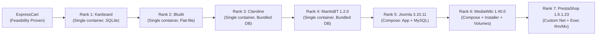

# T02 — G0 Environment Rollout Plan (7 Remaining Applications)

> **Program:** BEWT-CovExt  
> **Task:** T02 — Benchmark Audit (Parallel Worktree)  
> **Scope Document:** `De_cuong_BEWT_CovExt_AI_Agent_8_Web_40_Kich_Ban.docx` (v2.0, 20/10/2026)  
> **Base Commit of main:** `7e27950b44473cf4d6a5d7d5222bc8dac9b3a266` (following merge of PR #3 / T01-B)  
> **Target Gate:** G0 (Environment Readiness & Baseline Verification)  
> **Audit Date:** 2026-11-08  
> **Execution Phase:** Pre-implementation Static Specification for Task T03 (Zero Docker commands executed in T02)

---

## 1. G0 Gate Requirements (Per Acceptance Matrix)

According to `docs/program/ACCEPTANCE-MATRIX.md`, the G0 Environment Gate requires the following verifiable evidence for each application:
1. **Source / Image Pin:** Pinned version, source repository/commit, and Docker image digest recorded in `config/apps/<app>.json`.
2. **Runtime Isolation:** Docker deployment using unique project/container names that do not conflict with or affect external host resources.
3. **HTTP / DB Readiness:** Confirmed healthcheck showing HTTP 200/302 response and database accessibility.
4. **Baseline Execution Proof:** Execution of **at least one original Base test class** with assertions passing (`PASS`).
5. **Reset & Teardown Verification:** Verification that tearing down the container/volumes returns the host to a clean state, with subsequent re-execution producing identical results.

> [!IMPORTANT]
> ExpressCart has already satisfied G0 feasibility in Sprint 01 (`AddUserTest` PASS, isolated Mongo volume). The remaining seven applications are currently marked `NOT_VERIFIED`. T02 provides the static blueprint; Task T03 will execute the actual G0 rollout.
>
> **CRITICAL DATA RESET PRINCIPLE:** Simply calling `docker rm` or `docker stop` is **NOT proof of clean data reset** if host directory mounts or named volumes persist. A clean reset requires inspecting `.Mounts`, removing verified volumes, and proving reproducible fresh initialization.

---

## 2. Complexity Ranking & Rollout Sequence

To maximize velocity and de-risk the program, rollout is ordered from the lowest setup complexity and operational risk to the highest:



| Rank | Application | Complexity Score | Deployment Model | DB Engine | Setup Procedure | Reset Procedure | Primary Risk Factor |
|---|---|---|---|---|---|---|---|
| **1** | **Kanboard** | **1/5 (Trivial)** | Single container | SQLite 3 | None (pre-configured) | Verified container stop + anonymous volume removal | Port 8080 collision |
| **2** | **Bludit** | **2/5 (Low)** | Single container | Flat-file JSON | JUnit `Installer` test | Verified container stop + volume removal | Hardcoded LAN IP in BaseTest |
| **3** | **Claroline** | **2/5 (Low)** | Single container | Bundled MySQL | None (pre-configured) | Verified container stop + volume removal | Legacy PHP 5.6, Port 3000 |
| **4** | **MantisBT 1.2.0** | **2/5 (Low)** | Single container | Bundled MySQL | None (pre-configured) | Verified container stop + volume removal | Hardcoded LAN IP, Port 3000 |
| **5** | **Joomla 3.10.11** | **3/5 (Medium)** | 2 containers (Compose) | MySQL 5.6 | JUnit `Installer` + `RemoveMessages` | T03 ownership-verified Compose teardown; remove only verified run-owned volumes | Port 8080, MySQL startup latency |
| **6** | **MediaWiki 1.40.0** | **4/5 (High)** | 2 containers (Compose) | MariaDB | JUnit `Installer` + LocalSettings.php copy | T03 ownership-verified Compose teardown; remove only verified run-owned volumes | Volume data leaks, manual config copy |
| **7** | **PrestaShop 1.6.1.23**| **5/5 (Highest)**| 2 containers (Network) | MySQL 5.7 | JUnit `Installer` + guarded exec rm/mv | Verified container + volume + net removal | Deprecated image, complex post-exec |

---

## 3. Strict Safety & Isolation Rules for Task T03

To prevent accidental data loss, resource collisions, or unintended host modification:

1. **Unique Namespacing:** Never use generic or common container names (e.g., `some-mysql`, `some-prestashop`, `kanboard`, `bludit`, or `prestashop-net`). All containers, networks, and volumes must use the prefix:
   `bewt-covext-<app>-$runId` (e.g., `bewt-covext-kanboard-t03-01`).
2. **Mandatory Ownership Labels:** All created Docker resources must carry explicit labels:
   ```powershell
   --label "project=bewt-covext" `
   --label "owner=bewt-covext" `
   --label "app=<app>" `
   --label "task=t03-g0" `
   --label "runId=$runId" `
   --label "managed-by=bewt-covext-agent"
   ```
3. **PowerShell Windows Syntax Standards:** All commands targeting host shells on Windows must use valid PowerShell syntax:
   - Line continuation character is the backtick (`` ` ``), **never** the Bash backslash (`\`).
   - Environment variables must use PowerShell syntax: `$env:VAR_NAME` or `${env:VAR_NAME}`, **never** `${VAR_NAME}`.
4. **Port Availability Pre-check:** Before launching any container, execute a host port check to confirm the port is not bound by an existing service:
   ```powershell
   $portBusy = Test-NetConnection -ComputerName localhost -Port $targetPort -InformationLevel Quiet
   if ($portBusy) {
     throw "PORT_CONFLICT_BLOCKED: Port $targetPort is currently in use on the host."
   }
   ```
5. **Credential Security:** Database root and user passwords must be passed via environment variables (e.g. `$env:EXPERIMENT_DB_ROOT_PASSWORD`), never hardcoded as plaintext in scripts or committed logs.
6. **Mount & Volume Inspection for Clean Reset:** Before declaring a clean reset, execute:
   ```powershell
   docker inspect $containerId --format '{{json .Mounts}}'
   ```
   Confirm all anonymous and named volumes are recorded and explicitly removed during cleanup.
7. **Zero Global Pruning:** Never execute global prune commands (`docker system prune`, `docker volume prune`, `docker network prune`). Cleanup commands must target strictly by verified container ID or labels.
8. **Ownership Verification Precondition for Cleanup:** Teardown commands must verify ownership labels before issuing stop or remove:
   ```powershell
   $verifiedContainers = docker ps -a -q `
     --filter "name=^/bewt-covext-<app>-$runId" `
     --filter "label=project=bewt-covext" `
     --filter "label=managed-by=bewt-covext-agent" `
     --filter "label=runId=$runId"

   if (-not $verifiedContainers) {
     Write-Warning "Teardown aborted: no verified container found matching bewt-covext-<app>-$runId with valid ownership labels."
   } else {
     docker inspect $verifiedContainers --format '{{json .Mounts}}'
     $verifiedContainers | ForEach-Object { docker stop $_; docker rm -v $_ }
   }
   ```
9. **Docker Compose Ownership Guard:** `docker compose ls` output and a Compose project name are discovery hints only; neither is ownership proof. Joomla and MediaWiki teardown is intentionally specified as pseudocode until implemented and reviewed in T03. Apply the same ownership checks to any Compose-backed experiment:
   - Capture the immutable `runId`, expected Compose project, normalized absolute Compose file path, and its SHA-256 before startup. The Compose file must define explicit `project=bewt-covext`, `managed-by=bewt-covext-agent`, `app`, `task=t03-g0`, `runId`, and `compose-file-sha256` labels on each created service and volume.
   - Enumerate candidate resources by Docker labels, then inspect every container's full labels. Require the expected Compose project label, custom ownership labels, exact run ID, expected app/task, expected Compose service allowlist, Compose config-files/working-directory labels matching the recorded file path, and a freshly calculated file SHA-256 matching the recorded digest and custom label. A name match or `com.docker.compose.project` alone is insufficient.
   - Inspect each container's mounts before teardown. Resolve every named/anonymous volume and bind mount to its owner. Remove only volumes carrying the matching Compose project and custom run ID labels and explicitly recorded in the run inventory. Block cleanup for external volumes, host bind mounts, missing/mismatched labels, unknown containers, or any ambiguous ownership; do not use `down --volumes` or `--remove-orphans` as a shortcut.
   - Only after all resources pass those checks may T03 invoke Compose using the same verified file and project, without deleting volumes implicitly. Remove separately only the exact verified run-owned volumes/networks that the run created.
   - After teardown, inspect by the full ownership-label set and assert that no run-owned containers, networks, or volumes remain; verify mount paths are absent or in their recorded clean state. Compare pre/post inventories to confirm unrelated resources were untouched, and retain command output plus before/after resource IDs as evidence. Any mismatch is `BLOCKED` and requires human review.
10. **Working Copy for BaseTest URL Fix:** Because `BaseTest.java` in `bewt-original/` hardcodes `192.168.1.141` as a string literal and does NOT read `-Dapp.url`, Task T03 must instantiate an isolated working copy (e.g. `experiments/<app>/bewt-suite`), where `BaseTest.java` is parameterized to read `System.getProperty("app.url")`. `bewt-original/` remains strictly read-only.
11. **Image Pull Verification:** Do not claim an image tag exists on Docker Hub or runs until `docker pull` succeeds and records the sha256 registry digest.

---

## 4. Step-by-Step Rollout Specifications for T03

In the specifications below, `$runId = "t03-01"` represents the unique run identifier.

### Phase 1: Kanboard 1.2.15 (Rank 1 — Estimated Time: 0.5 Day)
1. **Port Check:** Confirm port 8080 is available:
   ```powershell
   if (Test-NetConnection -ComputerName localhost -Port 8080 -InformationLevel Quiet) { throw "Port 8080 busy" }
   ```
2. **Container Start:**
   ```powershell
   $runId = "t03-01"
   docker run -d --name "bewt-covext-kanboard-$runId" `
     --label "project=bewt-covext" `
     --label "owner=bewt-covext" `
     --label "app=kanboard" `
     --label "task=t03-g0" `
     --label "runId=$runId" `
     --label "managed-by=bewt-covext-agent" `
     -p 8080:80 kanboard/kanboard:v1.2.15
   ```
3. **Readiness Probe:** `Invoke-WebRequest -Uri http://localhost:8080 -UseBasicParsing` (Expect HTTP 200).
4. **Working Copy & Base Test Target:** Run `AddNewProject.java` inside `experiments/kanboard/bewt-suite`.
5. **Teardown & Clean Reset Verification:**
   ```powershell
   $runId = "t03-01"
   $target = docker ps -a -q --filter "name=^/bewt-covext-kanboard-$runId$" --filter "label=project=bewt-covext" --filter "label=runId=$runId"
   if ($target) {
     docker inspect $target --format '{{json .Mounts}}'
     docker stop $target
     docker rm -v $target
   }
   ```

---

### Phase 2: Bludit 2.3.4 (Rank 2 — Estimated Time: 0.5 Day)
1. **Port Check:** Confirm port 8080 is available.
2. **Container Start:**
   ```powershell
   $runId = "t03-01"
   docker run -d --name "bewt-covext-bludit-$runId" `
     --label "project=bewt-covext" `
     --label "owner=bewt-covext" `
     --label "app=bludit" `
     --label "task=t03-g0" `
     --label "runId=$runId" `
     --label "managed-by=bewt-covext-agent" `
     -p 8080:80 bludit/docker:2.3.4
   ```
3. **Working Copy Setup:** Copy `bewt-original/bludit/baseline/bludit-2.3.4` to `experiments/bludit/bewt-suite`, patch `BaseTest.java` in working copy to read `System.getProperty("app.url", "http://localhost:8080/admin")`.
4. **Initialization:** Run `mvn -Dtest=Installer test` inside `experiments/bludit/bewt-suite`.
5. **Base Test Target:** `AddContentTest.java`.
6. **Teardown & Clean Reset Verification:**
   ```powershell
   $runId = "t03-01"
   $target = docker ps -a -q --filter "name=^/bewt-covext-bludit-$runId$" --filter "label=project=bewt-covext" --filter "label=runId=$runId"
   if ($target) {
     docker inspect $target --format '{{json .Mounts}}'
     docker stop $target
     docker rm -v $target
   }
   ```

---

### Phase 3: Claroline 1.11.10 (Rank 3 — Estimated Time: 0.5 Day)
1. **Port Check:** Confirm port 3000 is available.
2. **Container Start:**
   ```powershell
   $runId = "t03-01"
   docker run -it -d --name "bewt-covext-claroline-$runId" `
     --label "project=bewt-covext" `
     --label "owner=bewt-covext" `
     --label "app=claroline" `
     --label "task=t03-g0" `
     --label "runId=$runId" `
     --label "managed-by=bewt-covext-agent" `
     --workdir=/home/claroline -p 3000:80 `
     --entrypoint ./run-services-docker.sh olianasd/claroline-strongpsw bash
   ```
3. **Readiness Probe:** Check `http://localhost:3000/claroline11110/claroline/index.php`.
4. **Base Test Target:** `Claroline_AddUserTest.java` on working copy `experiments/claroline/bewt-suite`.
5. **Teardown & Clean Reset Verification:**
   ```powershell
   $runId = "t03-01"
   $target = docker ps -a -q --filter "name=^/bewt-covext-claroline-$runId$" --filter "label=project=bewt-covext" --filter "label=runId=$runId"
   if ($target) {
     docker inspect $target --format '{{json .Mounts}}'
     docker stop $target
     docker rm -v $target
   }
   ```

---

### Phase 4: MantisBT 1.2.0 (Rank 4 — Estimated Time: 0.5 Day)
1. **Port Check:** Confirm port 3000 is available.
2. **Container Start:**
   ```powershell
   $runId = "t03-01"
   docker run -it -d --name "bewt-covext-mantisbt-$runId" `
     --label "project=bewt-covext" `
     --label "owner=bewt-covext" `
     --label "app=mantisbt" `
     --label "task=t03-g0" `
     --label "runId=$runId" `
     --label "managed-by=bewt-covext-agent" `
     --workdir=/home -p 3000:80 `
     --entrypoint ./run-services-docker.sh olianasd/mantisbt-strongpsw:1.2.0 bash
   ```
3. **Working Copy Setup:** Copy to `experiments/mantisbt/bewt-suite`, patch `BaseTest.java` to read `System.getProperty("app.url", "http://localhost:3000/mantisbt")`.
4. **Base Test Target:** `AddUser.java`.
5. **Teardown & Clean Reset Verification:**
   ```powershell
   $runId = "t03-01"
   $target = docker ps -a -q --filter "name=^/bewt-covext-mantisbt-$runId$" --filter "label=project=bewt-covext" --filter "label=runId=$runId"
   if ($target) {
     docker inspect $target --format '{{json .Mounts}}'
     docker stop $target
     docker rm -v $target
   }
   ```

---

### Phase 5: Joomla 3.10.11 (Rank 5 — Estimated Time: 1.0 Day)
1. **Port Check:** Confirm port 8080 is available.
2. **Compose Launch:** Use unique project name `bewt-covext-joomla-$runId`:
   ```powershell
   T03_IMPLEMENTATION_REQUIRED — PSEUDOCODE ONLY; do not execute in T02.
   1. Create an experiment-owned Compose working copy from the pinned read-only source file; do not edit `bewt-original/`.
   2. Add exact project/manager/app/task/runId/compose-file-sha256 labels to both services and every owned named volume. Record source file commit/hash and working-copy absolute path/hash before startup.
   3. Launch only with the recorded working copy and unique project: docker compose -f <verified-joomla-compose-copy> -p "bewt-covext-joomla-$runId" up -d
   ```
3. **Readiness Probe:** Wait for MySQL healthcheck and HTTP 200 on `http://localhost:8080`.
4. **Initialization:** Run `mvn -Dtest=Installer test` and `mvn -Dtest=RemoveMessages test` on working copy.
5. **Base Test Target:** `AdminLoginTest.java` or `AddNewArticle.java`.
6. **Teardown & Clean Reset Verification:**
   ```powershell
   T03_IMPLEMENTATION_REQUIRED — PSEUDOCODE ONLY; do not execute in T02.
   1. Load the recorded Joomla runId, expected project, normalized Compose file path and SHA-256.
   2. Enumerate containers by labels; inspect every candidate and require exact custom project/manager/app/task/runId/compose-file-sha256 labels, the expected com.docker.compose.project, expected service names (web and database), and Compose config-files/working-directory identity matching the recorded file path. Recalculate the Compose file SHA-256 and compare it with the recorded digest and labels. A project-name lookup or `docker compose ls` result alone does not establish ownership.
   3. Inspect every .Mounts entry. Resolve and inspect each volume; require both matching Compose project labels and explicit `runId`/app ownership labels from the launch inventory. Classify bind/external/unlabeled/mismatched mounts as BLOCKED and stop before teardown.
   4. If every container, network and removable volume exactly matches the run inventory, invoke Compose with the same verified file and project, without `--volumes` or `--remove-orphans`; then remove only exact volume/network IDs independently verified as created by this run.
   5. Inspect again and assert zero resources with the full run ownership labels, record remaining mounts/volume inventory, and compare host resource IDs against the pre-run snapshot to show unrelated resources are unchanged. Missing or conflicting proof is BLOCKED and requires human review.
   ```

---

### Phase 6: MediaWiki 1.40.0 (Rank 6 — Estimated Time: 1.0 Day)
1. **Port Check:** Confirm port 8080 is available.
2. **Compose Launch:** Use unique project name `bewt-covext-mediawiki-$runId`:
   ```powershell
   T03_IMPLEMENTATION_REQUIRED — PSEUDOCODE ONLY; do not execute in T02.
   1. Create an experiment-owned Compose working copy from the pinned read-only source file; do not edit `bewt-original/`.
   2. Add exact project/manager/app/task/runId/compose-file-sha256 labels to both services and every owned named volume. Record source file commit/hash and working-copy absolute path/hash before startup.
   3. Launch only with the recorded working copy and unique project: docker compose -f <verified-mediawiki-compose-copy> -p "bewt-covext-mediawiki-$runId" up -d
   ```
3. **Initialization:** Run `mvn -Dtest=Installer test` on working copy.
4. **Config Provisioning Specification [T03_IMPLEMENTATION_REQUIRED]:**
   ```text
   PSEUDOCODE:
   1. Precondition: Check container 'bewt-covext-mediawiki-$runId-mediawiki-1' is running and labeled 'project=bewt-covext'.
   2. Verify source file 'LocalSettings.php' exists in working directory.
   3. Execute copy command:
      docker cp LocalSettings.php "bewt-covext-mediawiki-$runId-mediawiki-1:/var/www/html/LocalSettings.php"
   4. Verify file exists in container and permissions are 0644.
   ```
5. **Base Test Target:** `CreateUserTest.java` on working copy.
6. **Teardown & Clean Reset Verification:**
   ```powershell
   T03_IMPLEMENTATION_REQUIRED — PSEUDOCODE ONLY; do not execute in T02.
   1. Load the recorded MediaWiki runId, expected project, normalized Compose file path and SHA-256.
   2. Enumerate containers by labels; inspect every candidate and require exact custom project/manager/app/task/runId/compose-file-sha256 labels, the expected com.docker.compose.project, expected service names (MediaWiki and database), and Compose config-files/working-directory identity matching the recorded file path. Recalculate the Compose file SHA-256 and compare it with the recorded digest and labels. A project-name lookup or `docker compose ls` result alone does not establish ownership.
   3. Inspect every .Mounts entry, including the MediaWiki data/config mounts. Resolve each volume and require matching Compose project plus explicit runId/app ownership labels and a matching pre-run inventory record. Treat bind mounts, external volumes, or missing/mismatched ownership as BLOCKED; never remove them.
   4. If all resources exactly match the run inventory, invoke Compose with the same verified file and project, without `--volumes` or `--remove-orphans`; remove separately only exact volume/network IDs proven to belong to this run.
   5. Inspect again and assert zero resources with the full run ownership labels; verify the generated LocalSettings.php/config mount state and data volumes are absent or clean as specified. Compare pre/post resource IDs to confirm unrelated Docker resources remain unchanged, and retain teardown evidence. Missing or conflicting proof is BLOCKED and requires human review.
   ```

---

### Phase 7: PrestaShop 1.6.1.23 (Rank 7 — Estimated Time: 1.0 Day)
1. **Port Check:** Confirm ports 8080 and 3307 are available.
2. **Network & Container Launch:**
   ```powershell
   $runId = "t03-01"
   $netName = "bewt-covext-prestashop-$runId-net"
   docker network create $netName `
     --label "project=bewt-covext" `
     --label "owner=bewt-covext" `
     --label "app=prestashop" `
     --label "task=t03-g0" `
     --label "runId=$runId" `
     --label "managed-by=bewt-covext-agent"

   docker run -d --name "bewt-covext-prestashop-$runId-mysql" `
     --network $netName `
     --label "project=bewt-covext" `
     --label "owner=bewt-covext" `
     --label "app=prestashop" `
     --label "task=t03-g0" `
     --label "runId=$runId" `
     --label "managed-by=bewt-covext-agent" `
     -e "MYSQL_ROOT_PASSWORD=$env:EXPERIMENT_DB_ROOT_PASSWORD" `
     -p 3307:3306 mysql:5.7

   docker run -d --name "bewt-covext-prestashop-$runId-app" `
     --network $netName `
     --label "project=bewt-covext" `
     --label "owner=bewt-covext" `
     --label "app=prestashop" `
     --label "task=t03-g0" `
     --label "runId=$runId" `
     --label "managed-by=bewt-covext-agent" `
     -e "DB_SERVER=bewt-covext-prestashop-$runId-mysql" `
     -p 8080:80 prestashop/prestashop:1.6.1.23
   ```
3. **Working Copy Setup:** Copy to `experiments/prestashop/bewt-suite`, patch `BaseTest.java` to read `System.getProperty("app.url", "http://localhost:8080/administrator/")`.
4. **Initialization:** Run `mvn -Dtest=Installer test` on working copy.
5. **Post-install Adjustments Specification [T03_IMPLEMENTATION_REQUIRED]:**
   ```text
   PSEUDOCODE:
   1. Precondition: Check container 'bewt-covext-prestashop-$runId-app' is running and has label 'project=bewt-covext'.
   2. Verify installer completed successfully.
   3. Execute guarded directory rename inside the verified container:
      docker exec "bewt-covext-prestashop-$runId-app" bash -c "rm -rf install && mv admin administrator"
   4. Verify '/var/www/html/install' is absent and '/var/www/html/administrator' exists.
   ```
6. **Base Test Target:** `AddNewProduct.java`.
7. **Teardown & Clean Reset Verification:**
   ```powershell
   $runId = "t03-01"
   $appContainer = "bewt-covext-prestashop-$runId-app"
   $dbContainer = "bewt-covext-prestashop-$runId-mysql"
   $netName = "bewt-covext-prestashop-$runId-net"

   $verifiedApp = docker ps -a -q --filter "name=^/$appContainer$" --filter "label=project=bewt-covext" --filter "label=runId=$runId"
   $verifiedDb = docker ps -a -q --filter "name=^/$dbContainer$" --filter "label=project=bewt-covext" --filter "label=runId=$runId"

   if ($verifiedApp) {
     docker inspect $verifiedApp --format '{{json .Mounts}}'
     docker stop $verifiedApp; docker rm -v $verifiedApp
   }
   if ($verifiedDb) {
     docker inspect $verifiedDb --format '{{json .Mounts}}'
     docker stop $verifiedDb; docker rm -v $verifiedDb
   }
   $verifiedNet = docker network ls -q --filter "name=^$netName$" --filter "label=project=bewt-covext"
   if ($verifiedNet) {
     docker network rm $netName
   }
   ```
