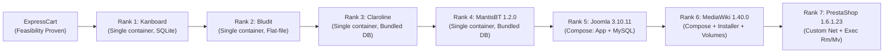

# T02 — G0 Environment Rollout Plan (7 Remaining Applications)

> **Program:** BEWT-CovExt  
> **Task:** T02 — Benchmark Audit (Parallel Worktree)  
> **Scope Document:** `De_cuong_BEWT_CovExt_AI_Agent_8_Web_40_Kich_Ban.docx` (v2.0, 20/10/2026)  
> **Target Gate:** G0 (Environment Readiness & Baseline Verification)  
> **Audit Date:** 2026-11-08  
> **Execution Phase:** Pre-implementation Plan for Task T03

---

## 1. G0 Gate Requirements (Per Acceptance Matrix)

According to `docs/program/ACCEPTANCE-MATRIX.md`, the G0 Environment Gate requires the following verifiable evidence for each application:
1. **Source / Image Pin:** Pinned version, source repository/commit, and Docker image digest recorded in `config/apps/<app>.json`.
2. **Runtime Isolation:** Docker deployment using unique project/container names that do not conflict with or affect external host resources.
3. **HTTP / DB Readiness:** Confirmed healthcheck showing HTTP 200/302 response and database accessibility.
4. **Baseline Execution Proof:** Execution of **at least one original Base test class** with assertions passing (`PASS`).
5. **Reset & Teardown Verification:** Verification that tearing down the container/volumes returns the host to a clean state, with subsequent re-execution producing identical results.

> [!IMPORTANT]
> ExpressCart has already satisfied G0 feasibility in Sprint 01 (`AddUserTest` PASS, isolated Mongo volume). The remaining seven applications are currently marked `NOT_VERIFIED`. T02 provides the static blueprint; Task T03 will execute the actual G0 rollout.

---

## 2. Complexity Ranking & Rollout Sequence

To maximize velocity and de-risk the program, rollout is ordered from the lowest setup complexity and operational risk to the highest:



| Rank | Application | Complexity Score | Deployment Model | DB Engine | Setup Procedure | Reset Procedure | Primary Risk Factor |
|---|---|---|---|---|---|---|---|
| **1** | **Kanboard** | **1/5 (Trivial)** | Single container | SQLite 3 | None (pre-configured) | `docker stop; rm` | Port 8080 collision |
| **2** | **Bludit** | **2/5 (Low)** | Single container | Flat-file JSON | JUnit `Installer` test | `docker stop; rm` | Hardcoded LAN IP in BaseTest |
| **3** | **Claroline** | **2/5 (Low)** | Single container | Bundled MySQL | None (pre-configured) | `docker stop; rm` | Legacy PHP 5.6, Port 3000 |
| **4** | **MantisBT 1.2.0** | **2/5 (Low)** | Single container | Bundled MySQL | None (pre-configured) | `docker stop; rm` | Hardcoded LAN IP, Port 3000 |
| **5** | **Joomla 3.10.11** | **3/5 (Medium)** | 2 containers (Compose) | MySQL 5.6 | JUnit `Installer` + `RemoveMessages` | Compose down | Port 8080, MySQL startup latency |
| **6** | **MediaWiki 1.40.0** | **4/5 (High)** | 2 containers (Compose) | MariaDB | JUnit `Installer` + `docker cp LocalSettings.php` | Compose down + remove 2 volumes | Volume data leaks, manual config copy |
| **7** | **PrestaShop 1.6.1.23**| **5/5 (Highest)**| 2 containers (Network) | MySQL 5.7 | JUnit `Installer` + container exec `rm/mv` | Container stop; rm; network keep | Deprecated image, complex post-exec |

---

## 3. Step-by-Step Rollout Specifications for T03

### Phase 1: Kanboard 1.2.15 (Rank 1 — Estimated Time: 0.5 Day)
1. **Container Start:** `docker run -d --name kanboard-test -p 8080:80 kanboard/kanboard:v1.2.15`
2. **Readiness Probe:** `curl -s -I http://localhost:8080 | grep "HTTP/1.1 200 OK"`
3. **Base Test Target:** `AddNewProject.java` or `AddNewTask.java`.
4. **Command:** `mvn -Dtest=AddNewProject test` inside `bewt-original/kanboard/baseline/kanboard-1.2.15`.
5. **Teardown & Verification:** `docker stop kanboard-test; docker rm kanboard-test`. Verify no lingering volumes.

---

### Phase 2: Bludit 2.3.4 (Rank 2 — Estimated Time: 0.5 Day)
1. **Container Start:** `docker run -d --name bludit-test -p 8080:80 bludit/docker:2.3.4`
2. **URL Override:** Pass `-Dapp.url=http://localhost:8080/admin` to Maven to bypass the hardcoded `192.168.1.141`.
3. **Initialization:** Run `mvn -Dtest=Installer test` inside `bewt-original/bludit/baseline/bludit-2.3.4`.
4. **Base Test Target:** `AddContentTest.java`.
5. **Teardown & Verification:** `docker stop bludit-test; docker rm bludit-test`.

---

### Phase 3: Claroline 1.11.10 (Rank 3 — Estimated Time: 0.5 Day)
1. **Container Start:**
   ```powershell
   docker run -it --workdir=/home/claroline --name=claroline-test -p 3000:80 -d --entrypoint ./run-services-docker.sh olianasd/claroline-strongpsw bash
   ```
2. **Readiness Probe:** Check `http://localhost:3000/claroline11110/claroline/index.php`.
3. **Base Test Target:** `Claroline_AddUserTest.java`.
4. **Teardown & Verification:** `docker stop claroline-test; docker rm claroline-test`.

---

### Phase 4: MantisBT 1.2.0 (Rank 4 — Estimated Time: 0.5 Day)
1. **Container Start:**
   ```powershell
   docker run -it --workdir=/home --name=mantisbt-test -p 3000:80 -d --entrypoint ./run-services-docker.sh olianasd/mantisbt-strongpsw:1.2.0 bash
   ```
2. **URL Override:** Pass `-Dapp.url=http://localhost:3000/mantisbt` to bypass hardcoded `192.168.1.141`.
3. **Base Test Target:** `AddUser.java`.
4. **Teardown & Verification:** `docker stop mantisbt-test; docker rm mantisbt-test`.

---

### Phase 5: Joomla 3.10.11 (Rank 5 — Estimated Time: 1.0 Day)
1. **Compose Launch:** `docker compose -f bewt-original/joomla/baseline/joomla-3.10.11/docker-compose.yml -p bewt-joomla up -d`
2. **Readiness Probe:** Wait for MySQL container health (port 3306) and HTTP 200 on `http://localhost:8080`.
3. **Initialization:**
   ```powershell
   mvn -Dtest=Installer test
   mvn -Dtest=RemoveMessages test
   ```
4. **Base Test Target:** `AdminLoginTest.java` or `AddNewArticle.java`.
5. **Teardown & Verification:** `docker compose -p bewt-joomla down --volumes`.

---

### Phase 6: MediaWiki 1.40.0 (Rank 6 — Estimated Time: 1.0 Day)
1. **Compose Launch:** `docker compose -f bewt-original/mediawiki/baseline/mediawiki-1.40.0/docker-compose.yml -p bewt-mediawiki up -d`
2. **Initialization:** Run `mvn -Dtest=Installer test`.
3. **Config Provisioning:**
   ```powershell
   docker cp LocalSettings.php bewt-mediawiki-mediawiki-1:/var/www/html/LocalSettings.php
   ```
4. **Base Test Target:** `CreateUserTest.java` or `CreatePageTest.java`.
5. **Teardown & Verification:**
   ```powershell
   docker compose -p bewt-mediawiki down --volumes --remove-orphans
   ```
   Verify removal of named volumes `bewt-mediawiki_images` and `bewt-mediawiki_db`.

---

### Phase 7: PrestaShop 1.6.1.23 (Rank 7 — Estimated Time: 1.0 Day)
1. **Network & Container Launch:**
   ```powershell
   docker network create prestashop-g0-net
   docker run --name prestashop-g0-mysql --network prestashop-g0-net -e MYSQL_ROOT_PASSWORD=admin -p 3307:3306 -d mysql:5.7
   docker run --name prestashop-g0-app --network prestashop-g0-net -e DB_SERVER=prestashop-g0-mysql -p 8080:80 -d prestashop/prestashop:1.6.1.23
   ```
2. **URL Override:** Pass `-Dapp.url=http://localhost:8080/administrator/` to bypass `192.168.1.141`.
3. **Initialization:** Run `mvn -Dtest=Installer test`.
4. **Post-install Adjustments:**
   ```powershell
   docker exec prestashop-g0-app bash -c "rm -rf install && mv admin administrator"
   ```
5. **Base Test Target:** `AddNewProduct.java`.
6. **Teardown & Verification:**
   ```powershell
   docker stop prestashop-g0-app prestashop-g0-mysql
   docker rm prestashop-g0-app prestashop-g0-mysql
   docker network rm prestashop-g0-net
   ```

---

## 4. Workstation Safeguards & Execution Invariants

1. **Strictly Sequential Execution:** Never run two SUT containers simultaneously. Ensure previous containers and networks are completely destroyed before starting the next phase.
2. **Ownership Labels:** Every container, network, and volume created must include the label `owner=bewt-covext` and `task=t03-g0`.
3. **Zero Resource Leaks:** The cleanup script must assert that `docker ps -a` and `docker volume ls` contain zero residual items tagged with the experiment prefix.
4. **Evidence Preservation:** Every smoke run must archive the raw Surefire XML (`TEST-*.xml`), terminal build log, and a screenshot of the running web UI into `docs/tasks/T03/evidence/<app>/`.
