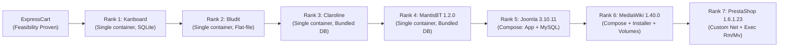

# T02 — G0 Environment Rollout Plan (7 Remaining Applications)

> **Program:** BEWT-CovExt  
> **Task:** T02 — Benchmark Audit (Parallel Worktree)  
> **Scope Document:** `De_cuong_BEWT_CovExt_AI_Agent_8_Web_40_Kich_Ban.docx` (v2.0, 20/10/2026)  
> **Base Commit of main:** `7e27950b44473cf4d6a5d7d5222bc8dac9b3a266` (following merge of PR #3 / T01-B)  
> **Target Gate:** G0 (Environment Readiness & Baseline Verification)  
> **Audit Date:** 2026-11-08  
> **Execution Phase:** Pre-implementation Plan for Task T03

---

## 1. G0 Gate Requirements (Per Acceptance Matrix)

According to `docs/program/ACCEPTANCE-MATRIX.md`, the G0 Environment Gate requires the following verifiable evidence for each application:
1. **Source / Image Pin:** Pinned version, source repository/commit, and Docker image digest recorded in `config/apps/<app>.json`.
2. **Runtime Isolation:** Docker deployment using unique project/container names that do not conflict with or affect external host resources.
3. **HTTP / DB Readiness:** Confirmed healthcheck showing HTTP 200/302 response and database accessibility.
4. **Baseline Execution Proof:** Execution of **at least one original Base test class** with assertions passing (`PASS`).
5. **Reset & Teardown Verification:** Verification that tearing down the container/volumes returns the host to a clean state, with subsequent re-execution producing identical results.

> [!IMPORTANT]
> ExpressCart has already satisfied G0 feasibility in Sprint 01 (`AddUserTest` PASS, isolated Mongo volume). The remaining seven applications are currently marked `NOT_VERIFIED`. T02 provides the static blueprint; Task T03 will execute the actual G0 rollout.

---

## 2. Complexity Ranking & Rollout Sequence

To maximize velocity and de-risk the program, rollout is ordered from the lowest setup complexity and operational risk to the highest:



| Rank | Application | Complexity Score | Deployment Model | DB Engine | Setup Procedure | Reset Procedure | Primary Risk Factor |
|---|---|---|---|---|---|---|---|
| **1** | **Kanboard** | **1/5 (Trivial)** | Single container | SQLite 3 | None (pre-configured) | `docker stop; rm` | Port 8080 collision |
| **2** | **Bludit** | **2/5 (Low)** | Single container | Flat-file JSON | JUnit `Installer` test | `docker stop; rm` | Hardcoded LAN IP in BaseTest |
| **3** | **Claroline** | **2/5 (Low)** | Single container | Bundled MySQL | None (pre-configured) | `docker stop; rm` | Legacy PHP 5.6, Port 3000 |
| **4** | **MantisBT 1.2.0** | **2/5 (Low)** | Single container | Bundled MySQL | None (pre-configured) | `docker stop; rm` | Hardcoded LAN IP, Port 3000 |
| **5** | **Joomla 3.10.11** | **3/5 (Medium)** | 2 containers (Compose) | MySQL 5.6 | JUnit `Installer` + `RemoveMessages` | Compose down | Port 8080, MySQL startup latency |
| **6** | **MediaWiki 1.40.0** | **4/5 (High)** | 2 containers (Compose) | MariaDB | JUnit `Installer` + `docker cp LocalSettings.php` | Compose down + remove 2 volumes | Volume data leaks, manual config copy |
| **7** | **PrestaShop 1.6.1.23**| **5/5 (Highest)**| 2 containers (Network) | MySQL 5.7 | JUnit `Installer` + container exec `rm/mv` | Container stop; rm; network keep | Deprecated image, complex post-exec |

---

## 3. Strict Safety & Isolation Rules for Task T03

To prevent accidental data loss, resource collisions, or unintended host modification:

1. **Unique Namespacing:** Never use generic or common container names (e.g., `some-mysql`, `some-prestashop`, `kanboard`, `bludit`, or `prestashop-net`). All containers, networks, and volumes must use the prefix:
   `bewt-covext-<app>-<runId>` (e.g., `bewt-covext-kanboard-t03-01`).
2. **Mandatory Ownership Labels:** All created Docker resources must carry explicit labels:
   ```bash
   --label "owner=bewt-covext" \
   --label "project=bewt-covext" \
   --label "app=<app>" \
   --label "task=t03-g0" \
   --label "runId=<runId>"
   ```
3. **Port Availability Pre-check:** Before launching any container, execute a host port check to confirm the port is not bound by an existing service:
   ```powershell
   Test-NetConnection -ComputerName localhost -Port <port> -InformationLevel Quiet
   ```
   If the port is occupied, abort with `PORT_CONFLICT_BLOCKED`.
4. **Credential Security:** Database root and user passwords must be passed via environment variables (e.g. `${EXPERIMENT_DB_ROOT_PASSWORD}`), never hardcoded as plaintext in scripts or committed logs.
5. **Mount & Volume Inspection:** Before declaring a clean reset, execute:
   ```powershell
   docker inspect <container> --format '{{json .Mounts}}'
   ```
   Confirm all anonymous and named volumes are recorded and explicitly removed during cleanup.
6. **Zero Global Pruning:** Never execute global prune commands (`docker system prune`, `docker volume prune`, `docker network prune`). Cleanup commands must target strictly by verified container ID or labels:
   ```powershell
   docker ps -q --filter "label=owner=bewt-covext" --filter "label=runId=<runId>" | ForEach-Object { docker stop $_; docker rm -v $_ }
   ```
7. **Container Filesystem Modification Guard:** Container exec commands (e.g., PrestaShop's directory cleanup) must target only the specifically verified container ID carrying the experiment label.
8. **Working Copy for BaseTest URL Fix:** Because `BaseTest.java` in `bewt-original/` hardcodes `192.168.1.141` as a string literal and does NOT read `-Dapp.url`, Task T03 must instantiate a working copy (e.g. `experiments/<app>/bewt-suite`), where `BaseTest.java` is parameterized to read `System.getProperty("app.url")`. `bewt-original/` remains strictly read-only.
9. **Image Pull Verification:** Do not claim an image tag exists on Docker Hub or runs until `docker pull` succeeds and records the sha256 registry digest.

---

## 4. Step-by-Step Rollout Specifications for T03

### Phase 1: Kanboard 1.2.15 (Rank 1 — Estimated Time: 0.5 Day)
1. **Port Check:** Confirm port 8080 is available.
2. **Container Start:**
   ```powershell
   docker run -d --name bewt-covext-kanboard-g0 \
     --label "owner=bewt-covext" --label "app=kanboard" --label "task=t03-g0" \
     -p 8080:80 kanboard/kanboard:v1.2.15
   ```
3. **Readiness Probe:** `curl -s -I http://localhost:8080 | grep "HTTP/1.1 200 OK"`
4. **Base Test Target:** `AddNewProject.java` on working copy `experiments/kanboard/bewt-suite`.
5. **Teardown & Verification:** `docker stop bewt-covext-kanboard-g0; docker rm -v bewt-covext-kanboard-g0`.

---

### Phase 2: Bludit 2.3.4 (Rank 2 — Estimated Time: 0.5 Day)
1. **Port Check:** Confirm port 8080 is available.
2. **Container Start:**
   ```powershell
   docker run -d --name bewt-covext-bludit-g0 \
     --label "owner=bewt-covext" --label "app=bludit" --label "task=t03-g0" \
     -p 8080:80 bludit/docker:2.3.4
   ```
3. **Working Copy Setup:** Copy `bewt-original/bludit/baseline/bludit-2.3.4` to `experiments/bludit/bewt-suite`, patch `BaseTest.java` to read `System.getProperty("app.url", "http://localhost:8080/admin")`.
4. **Initialization:** Run `mvn -Dtest=Installer test` inside `experiments/bludit/bewt-suite`.
5. **Base Test Target:** `AddContentTest.java`.
6. **Teardown & Verification:** `docker stop bewt-covext-bludit-g0; docker rm -v bewt-covext-bludit-g0`.

---

### Phase 3: Claroline 1.11.10 (Rank 3 — Estimated Time: 0.5 Day)
1. **Port Check:** Confirm port 3000 is available.
2. **Container Start:**
   ```powershell
   docker run -it -d --name bewt-covext-claroline-g0 \
     --label "owner=bewt-covext" --label "app=claroline" --label "task=t03-g0" \
     --workdir=/home/claroline -p 3000:80 \
     --entrypoint ./run-services-docker.sh olianasd/claroline-strongpsw bash
   ```
3. **Readiness Probe:** Check `http://localhost:3000/claroline11110/claroline/index.php`.
4. **Base Test Target:** `Claroline_AddUserTest.java` on working copy `experiments/claroline/bewt-suite`.
5. **Teardown & Verification:** `docker stop bewt-covext-claroline-g0; docker rm -v bewt-covext-claroline-g0`.

---

### Phase 4: MantisBT 1.2.0 (Rank 4 — Estimated Time: 0.5 Day)
1. **Port Check:** Confirm port 3000 is available.
2. **Container Start:**
   ```powershell
   docker run -it -d --name bewt-covext-mantisbt-g0 \
     --label "owner=bewt-covext" --label "app=mantisbt" --label "task=t03-g0" \
     --workdir=/home -p 3000:80 \
     --entrypoint ./run-services-docker.sh olianasd/mantisbt-strongpsw:1.2.0 bash
   ```
3. **Working Copy Setup:** Copy to `experiments/mantisbt/bewt-suite`, patch `BaseTest.java` to read `System.getProperty("app.url", "http://localhost:3000/mantisbt")`.
4. **Base Test Target:** `AddUser.java`.
5. **Teardown & Verification:** `docker stop bewt-covext-mantisbt-g0; docker rm -v bewt-covext-mantisbt-g0`.

---

### Phase 5: Joomla 3.10.11 (Rank 5 — Estimated Time: 1.0 Day)
1. **Port Check:** Confirm port 8080 is available.
2. **Compose Launch:** Use project name `bewt-covext-joomla-g0`:
   ```powershell
   docker compose -f bewt-original/joomla/baseline/joomla-3.10.11/docker-compose.yml -p bewt-covext-joomla-g0 up -d
   ```
3. **Readiness Probe:** Wait for MySQL health and HTTP 200 on `http://localhost:8080`.
4. **Initialization:** Run `mvn -Dtest=Installer test` and `mvn -Dtest=RemoveMessages test` on working copy.
5. **Base Test Target:** `AdminLoginTest.java` or `AddNewArticle.java`.
6. **Teardown & Verification:** `docker compose -p bewt-covext-joomla-g0 down --volumes`.

---

### Phase 6: MediaWiki 1.40.0 (Rank 6 — Estimated Time: 1.0 Day)
1. **Port Check:** Confirm port 8080 is available.
2. **Compose Launch:** Use project name `bewt-covext-mediawiki-g0`:
   ```powershell
   docker compose -f bewt-original/mediawiki/baseline/mediawiki-1.40.0/docker-compose.yml -p bewt-covext-mediawiki-g0 up -d
   ```
3. **Initialization:** Run `mvn -Dtest=Installer test` on working copy.
4. **Config Provisioning:**
   ```powershell
   docker cp LocalSettings.php bewt-covext-mediawiki-g0-mediawiki-1:/var/www/html/LocalSettings.php
   ```
5. **Base Test Target:** `CreateUserTest.java` on working copy.
6. **Teardown & Verification:**
   ```powershell
   docker compose -p bewt-covext-mediawiki-g0 down --volumes --remove-orphans
   ```

---

### Phase 7: PrestaShop 1.6.1.23 (Rank 7 — Estimated Time: 1.0 Day)
1. **Port Check:** Confirm port 8080 is available.
2. **Network & Container Launch:**
   ```powershell
   docker network create bewt-covext-prestashop-g0-net --label "owner=bewt-covext"
   docker run -d --name bewt-covext-prestashop-g0-mysql \
     --network bewt-covext-prestashop-g0-net \
     --label "owner=bewt-covext" \
     -e MYSQL_ROOT_PASSWORD=${EXPERIMENT_DB_ROOT_PASSWORD} \
     -p 3307:3306 mysql:5.7
   docker run -d --name bewt-covext-prestashop-g0-app \
     --network bewt-covext-prestashop-g0-net \
     --label "owner=bewt-covext" \
     -e DB_SERVER=bewt-covext-prestashop-g0-mysql \
     -p 8080:80 prestashop/prestashop:1.6.1.23
   ```
3. **Working Copy Setup:** Copy to `experiments/prestashop/bewt-suite`, patch `BaseTest.java` to read `System.getProperty("app.url", "http://localhost:8080/administrator/")`.
4. **Initialization:** Run `mvn -Dtest=Installer test` on working copy.
5. **Post-install Adjustments (Guarded to Owned Container):**
   ```powershell
   docker exec bewt-covext-prestashop-g0-app bash -c "rm -rf install && mv admin administrator"
   ```
6. **Base Test Target:** `AddNewProduct.java`.
7. **Teardown & Verification:**
   ```powershell
   docker stop bewt-covext-prestashop-g0-app bewt-covext-prestashop-g0-mysql
   docker rm -v bewt-covext-prestashop-g0-app bewt-covext-prestashop-g0-mysql
   docker network rm bewt-covext-prestashop-g0-net
   ```
